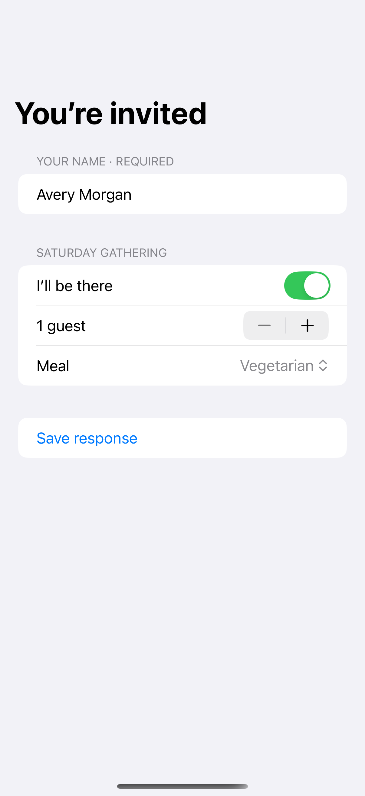

# Conditional forms and validation

Required fields and conditional questions make the form respond to the choices already made.

## SwiftUI

```swift
import SwiftUI

struct ConditionalGuestForm: View {
    @State private var attending = true
    @State private var guests = 1
    @State private var notes = ""

    var body: some View {
        Form {
            Toggle("I’ll be there", isOn: $attending)
            if attending {
                Stepper("Guests: \(guests)", value: $guests, in: 1...6)
                TextField("Dietary notes · optional", text: $notes, axis: .vertical)
            }
        }
    }
}
```

## Captures

<!-- captures:start -->
### iPhone 16 Pro · iOS 18.5

default. light appearance; Large text; en_US.


<!-- captures:end -->

## Example notes

All changes stay in this example; no account or remote data is modified.

## Full example

[Open the complete runnable example](ConditionalValidationFormDemo.swift).

## Reference

[Apple: Form](https://developer.apple.com/documentation/swiftui/form).
