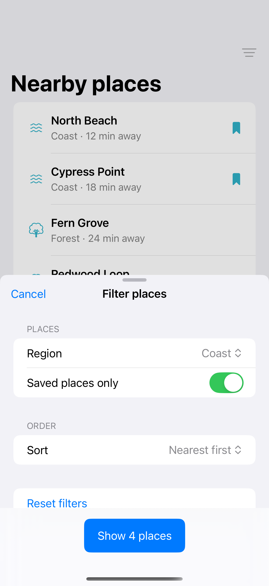

# Filter and sort sheets

A separate draft lets a sheet apply several filter and sort changes together.

## SwiftUI

```swift
import SwiftUI

struct DraftFilterSheet: View {
    @State private var savedOnly = false
    @State private var draft = false
    @State private var presented = false
    var body: some View {
        Button("Filters") { draft = savedOnly; presented = true }
            .sheet(isPresented: $presented) {
                NavigationStack {
                    Form { Toggle("Saved only", isOn: $draft) }
                        .navigationTitle("Filters")
                        .toolbar {
                            ToolbarItem(placement: .cancellationAction) { Button("Cancel") { presented = false } }
                            ToolbarItem(placement: .confirmationAction) { Button("Apply") { savedOnly = draft; presented = false } }
                        }
                }.presentationDetents([.medium])
            }
    }
}
```

## Captures

<!-- captures:start -->
### iPhone 16 Pro · iOS 18.5

default. light appearance; Large text; en_US.


<!-- captures:end -->

## Example notes

The sheet edits a draft, previews its result count, and applies only when Show places is selected. Cancel and swipe dismissal leave the saved filters unchanged. Places and travel times are fictional fixtures.

## Full example

[Open the complete runnable example](FilterSortSheetFlowDemo.swift).

## Reference

[Apple documentation](https://developer.apple.com/documentation/swiftui/view/sheet(ispresented:ondismiss:content:)).
