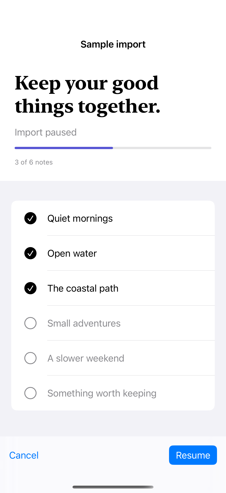

# Import progress and cancellation

A processing flow keeps progress, pause, cancellation, and completion tied to the same state.

## SwiftUI

```swift
import SwiftUI

struct CancellableProgress: View {
    @State private var completed = 0
    @State private var running = false

    var body: some View {
        VStack {
            ProgressView(value: Double(completed), total: 6)
            Button(running ? "Pause" : "Resume") { running.toggle() }
        }
        .task(id: running) {
            guard running else { return }
            while completed < 6 {
                do { try await Task.sleep(for: .milliseconds(300)) }
                catch { return }
                guard !Task.isCancelled else { return }
                completed += 1
            }
            running = false
        }
        .padding()
    }
}
```

## Captures

<!-- captures:start -->
### iPhone 16 Pro · iOS 18.5

default. light appearance; Large text; en_US.


<!-- captures:end -->

## Example notes

Processes six synthetic in-memory notes; no files are read. Capture mode runs the real processing loop, then pauses after the third item for a repeatable state.

## Full example

[Open the complete runnable example](ImportProgressFlowDemo.swift).

## Reference

[Apple: Form](https://developer.apple.com/documentation/swiftui/form).
