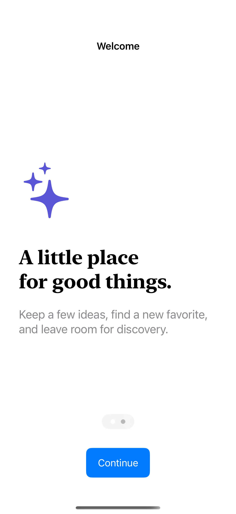

# Onboarding and preferences

A short introduction leads into useful choices and a clear completion state.

## SwiftUI

```swift
import SwiftUI

struct IntroPages: View {
    @State private var page = 0

    var body: some View {
        VStack {
            TabView(selection: $page) {
                Label("Keep good things close", systemImage: "bookmark").tag(0)
                Label("Find your next favorite", systemImage: "sparkles").tag(1)
            }
            .tabViewStyle(.page)
            Button("Continue") { withAnimation { page = min(1, page + 1) } }
        }
    }
}
```

## Captures

<!-- captures:start -->
### iPhone 16 Pro · iOS 18.5

default. light appearance; Large text; en_US.


<!-- captures:end -->

## Example notes

All changes stay in this example; no account or remote data is modified.

## Full example

[Open the complete runnable example](OnboardingPreferencesDemo.swift).

## Reference

[Apple: Form](https://developer.apple.com/documentation/swiftui/form).
