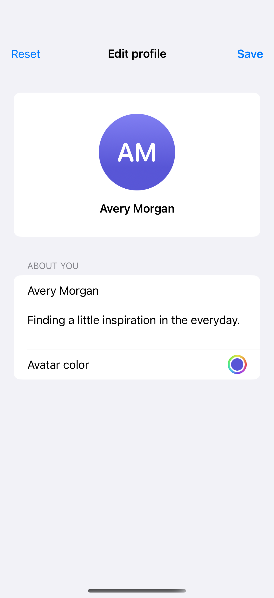

# Profile editing

An editable profile keeps its draft separate from the saved summary and offers an explicit way to reset changes.

## SwiftUI

```swift
import SwiftUI

struct EditableProfile: View {
    @State private var savedName = "Avery Morgan"
    @State private var name = "Avery Morgan"

    var body: some View {
        Form {
            TextField("Display name", text: $name).textContentType(.name)
            Button("Save") { savedName = name }
            Button("Reset") { name = savedName }
        }
    }
}
```

## Captures

<!-- captures:start -->
### iPhone 16 Pro · iOS 18.5

default. light appearance; Large text; en_US.


<!-- captures:end -->

## Example notes

All changes stay in this example; no account or remote data is modified.

## Full example

[Open the complete runnable example](ProfileEditingDemo.swift).

## Reference

[Apple: Form](https://developer.apple.com/documentation/swiftui/form).
