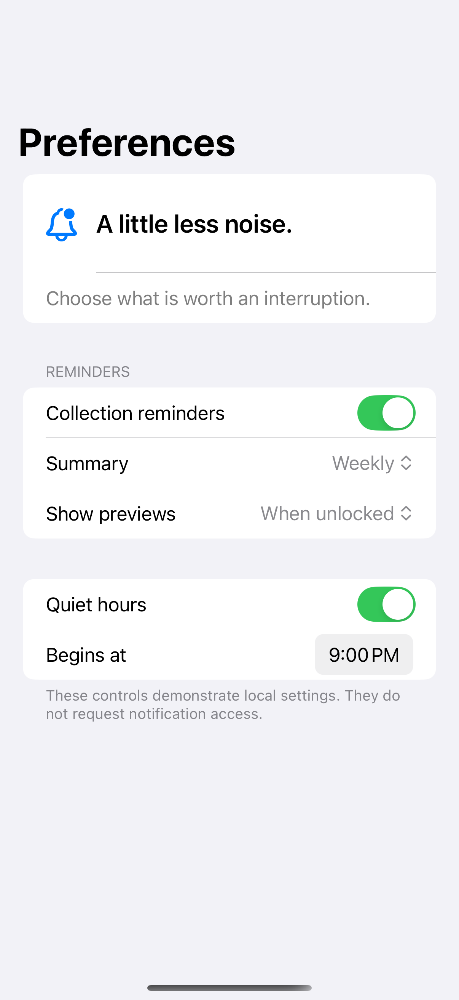

# Settings forms

Grouped settings expose preferences and reveal dependent options only when they apply.

## SwiftUI

```swift
import SwiftUI

struct DependentSettings: View {
    @State private var reminders = true
    @State private var frequency = "Weekly"

    var body: some View {
        Form {
            Section("Reminders") {
                Toggle("Enable reminders", isOn: $reminders)
                if reminders {
                    Picker("Summary", selection: $frequency) {
                        Text("Daily").tag("Daily")
                        Text("Weekly").tag("Weekly")
                    }
                }
            }
        }
    }
}
```

## Captures

<!-- captures:start -->
### iPhone 16 Pro · iOS 18.5

default. light appearance; Large text; en_US.


<!-- captures:end -->

## Example notes

All changes stay in this example; no account or remote data is modified.

## Full example

[Open the complete runnable example](SettingsFormDemo.swift).

## Reference

[Apple: Form](https://developer.apple.com/documentation/swiftui/form).
