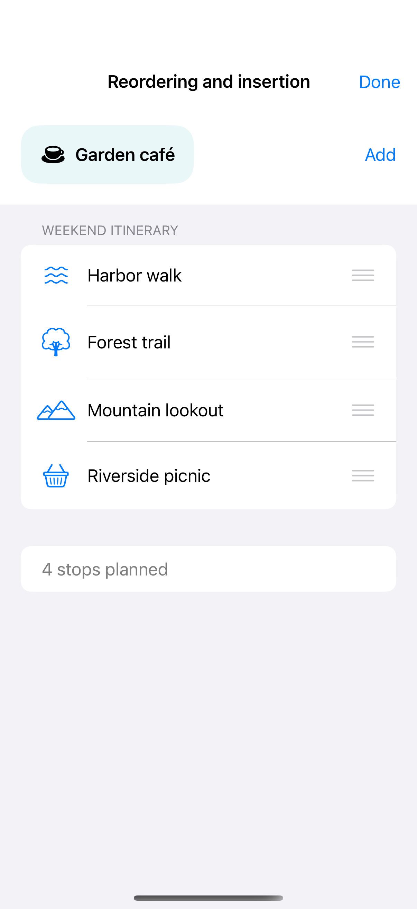

# Reordering and insertion

Editable lists provide native reorder handles, while a drop destination on the dynamic rows reports the insertion index and draws the system insertion indicator during a drag. Stable item identity preserves each row as the local collection moves; accessible move actions and an append button offer alternatives.

## SwiftUI

```swift
import SwiftUI

struct ReorderRecipe: View {
    @State private var items = ["Harbor", "Forest", "Mountain"]
    var body: some View {
        List {
            ForEach(items, id: \.self) { Text($0) }
                .onMove { items.move(fromOffsets: $0, toOffset: $1) }
                .dropDestination(for: String.self) { values, index in
                    let additions = values.filter { !$0.isEmpty && !items.contains($0) }
                    items.insert(contentsOf: Array(Set(additions)).sorted(), at: min(index, items.count))
                }
        }
        .environment(\.editMode, .constant(.active))
    }
}
```

## Captures

<!-- captures:start -->
### iPhone 16 Pro · iOS 18.5

default. light appearance; Large text; en_US.


<!-- captures:end -->

## Full example

[Open the complete runnable example](ReorderingInsertionDemo.swift).

## Reference

[Apple: gestures](https://developer.apple.com/design/human-interface-guidelines/gestures).
