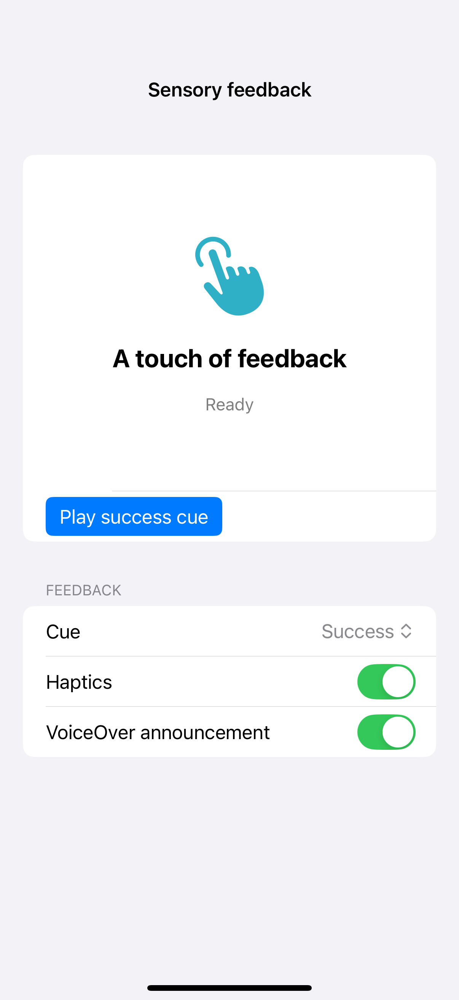

# Haptics and visible feedback

Sensory feedback can mark a selection, impact, success, warning, or error. Pair each requested haptic with a visible status and an optional VoiceOver announcement so the result does not depend on hardware, sound, or touch; simulators and still captures cannot demonstrate the haptic itself.

## SwiftUI

```swift
import SwiftUI

struct SensoryFeedbackRecipe: View {
    @State private var saves = 0
    var body: some View {
        VStack(spacing: 20) {
            Label(saves == 0 ? "Ready to save" : "Saved", systemImage: saves == 0 ? "bookmark" : "checkmark.circle.fill")
            Button("Save sample") { saves += 1 }
        }
        .sensoryFeedback(.success, trigger: saves)
    }
}
```

## Captures

<!-- captures:start -->
### iPhone 16 Pro · iOS 18.5

default. light appearance; Large text; en_US.


<!-- captures:end -->

## Full example

[Open the complete runnable example](SensoryFeedbackDemo.swift).

## Reference

[Apple: gestures](https://developer.apple.com/design/human-interface-guidelines/gestures).
