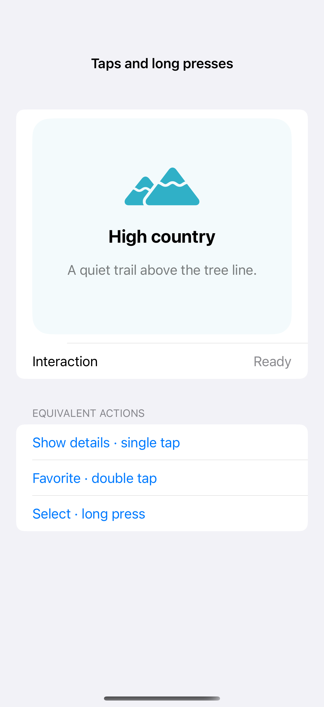

# Taps and long presses

Exclusive gestures give a long press, double tap, and single tap distinct actions on the same view. Gesture state resets when a touch ends or is cancelled, while named accessibility actions provide the same outcomes without timing a touch.

## SwiftUI

```swift
import SwiftUI

struct TapAndPressRecipe: View {
    @State private var result = "Ready"
    @GestureState private var pressing = false
    var body: some View {
        Text(result).padding(40).background(pressing ? Color.teal.opacity(0.2) : .gray.opacity(0.1))
            .gesture(LongPressGesture(minimumDuration: 0.6)
                .updating($pressing) { value, state, _ in state = value }
                .exclusively(before: TapGesture(count: 2).exclusively(before: TapGesture()))
                .onEnded { value in
                    switch value {
                    case .first: result = "Long press"
                    case .second(.first): result = "Double tap"
                    case .second(.second): result = "Single tap"
                    }
                })
            .accessibilityAction(named: "Single tap") { result = "Single tap" }
            .accessibilityAction(named: "Double tap") { result = "Double tap" }
            .accessibilityAction(named: "Long press") { result = "Long press" }
    }
}
```

## Captures

<!-- captures:start -->
### iPhone 16 Pro · iOS 18.5

default. light appearance; Large text; en_US.


<!-- captures:end -->

## Full example

[Open the complete runnable example](TapAndPressDemo.swift).

## Reference

[Apple: gestures](https://developer.apple.com/design/human-interface-guidelines/gestures).
