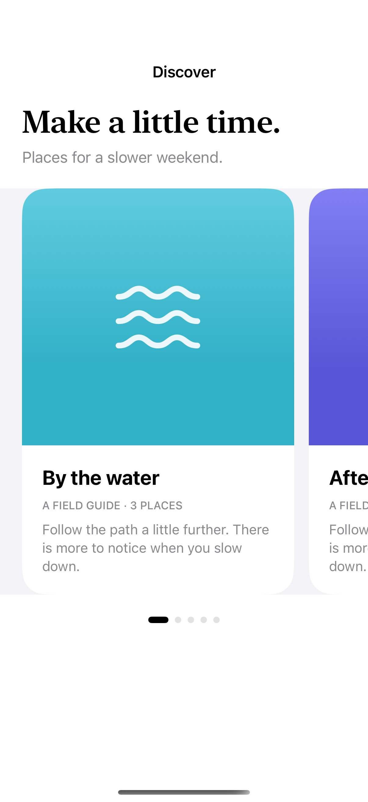
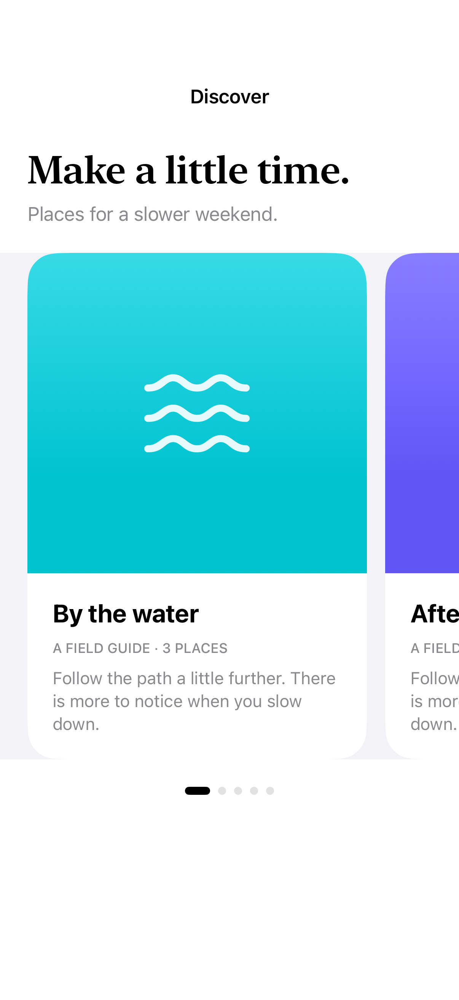

# Card carousels

A horizontal carousel can reveal the next card and snap each item into a readable position.

## SwiftUI

```swift
import SwiftUI

struct PeekingCarousel: View {
    var body: some View {
        ScrollView(.horizontal) {
            LazyHStack(spacing: 16) {
                ForEach(0..<5) { index in
                    Text("Place \(index + 1)")
                        .font(.title)
                        .frame(height: 280)
                        .containerRelativeFrame(.horizontal) { width, _ in width * 0.84 }
                        .background(.teal.opacity(0.15), in: .rect(cornerRadius: 24))
                }
            }
            .scrollTargetLayout()
        }
        .contentMargins(.horizontal, 24, for: .scrollContent)
        .scrollTargetBehavior(.viewAligned)
        .scrollIndicators(.hidden)
    }
}
```

## Captures

<!-- captures:start -->
### iPhone 16 Pro · iOS 18.5

default. light appearance; Large text; en_US.



### iPhone 17 Pro · iOS 26.5

default. light appearance; Large text; en_US.


<!-- captures:end -->

## Full example

[Open the complete runnable example](CardCarouselsDemo.swift).

## Reference

[Apple: scrollTargetBehavior](https://developer.apple.com/documentation/swiftui/view/scrolltargetbehavior(_:)).
