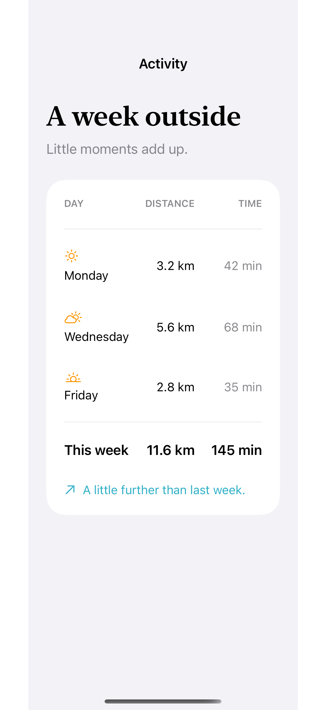
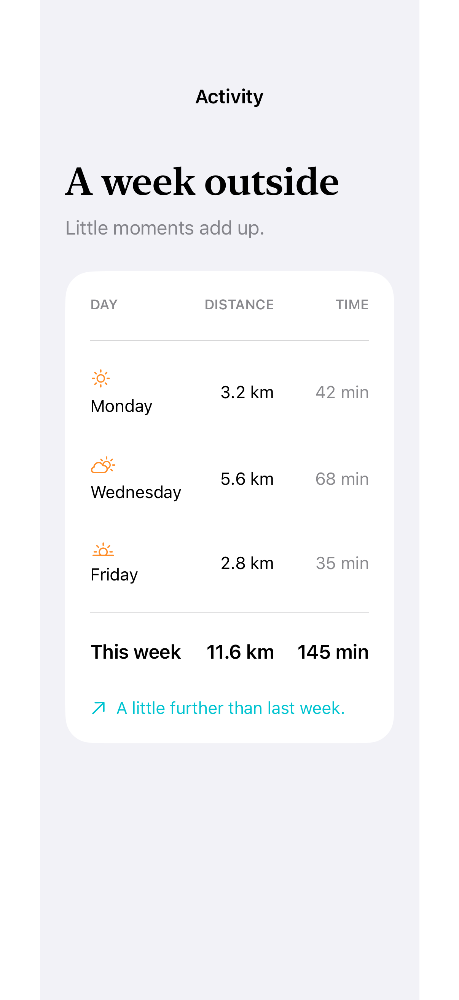

# Grid alignment and spans

A regular grid aligns rows and columns while selected cells span the whole arrangement.

## SwiftUI

```swift
import SwiftUI

struct SpanningGrid: View {
    var body: some View {
        Grid(horizontalSpacing: 24, verticalSpacing: 16) {
            Text("This week").font(.title2).gridCellColumns(2)
            Divider().gridCellColumns(2).gridCellUnsizedAxes(.horizontal)
            GridRow {
                Text("Distance").gridColumnAlignment(.leading)
                Text("11.6 km").gridColumnAlignment(.trailing)
            }
            GridRow {
                Text("Time outside")
                Text("145 min")
            }
        }
        .padding()
    }
}
```

## Captures

<!-- captures:start -->
### iPhone 16 Pro · iOS 18.5

default. light appearance; Large text; en_US.



### iPhone 17 Pro · iOS 26.5

default. light appearance; Large text; en_US.


<!-- captures:end -->

## Full example

[Open the complete runnable example](GridAlignmentSpanningDemo.swift).

## Reference

[Apple: Grid](https://developer.apple.com/documentation/swiftui/grid).
