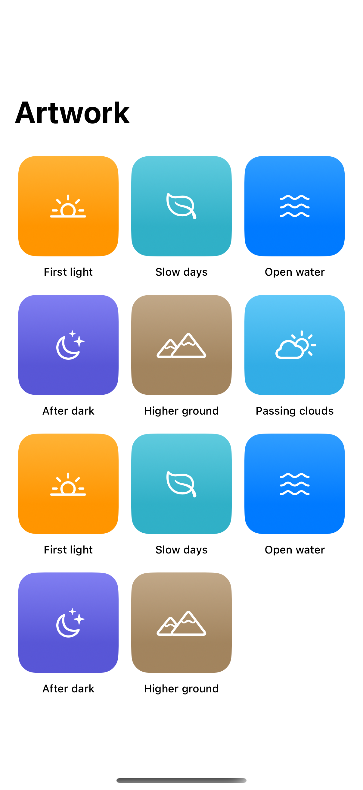

# Grid column sizing

Fixed, flexible, and adaptive columns control how a grid uses the available width.

## SwiftUI

```swift
import SwiftUI

struct AdaptiveArtwork: View {
    private let columns = [GridItem(.adaptive(minimum: 100), spacing: 16)]

    var body: some View {
        ScrollView {
            LazyVGrid(columns: columns, spacing: 16) {
                ForEach(0..<12) { index in
                    RoundedRectangle(cornerRadius: 16)
                        .fill(.teal.opacity(0.1))
                        .aspectRatio(1, contentMode: .fit)
                        .overlay {
                            Image(systemName: "leaf").font(.largeTitle)
                        }
                        .accessibilityLabel("Artwork \(index + 1)")
                }
            }
            .padding()
        }
    }
}
```

## Captures

<!-- captures:start -->
### iPhone 16 Pro · iOS 18.5

default. light appearance; Large text; en_US.


<!-- captures:end -->

## Full example

[Open the complete runnable example](GridColumnSizingDemo.swift).

## Reference

[Apple: LazyVGrid](https://developer.apple.com/documentation/swiftui/lazyvgrid).
