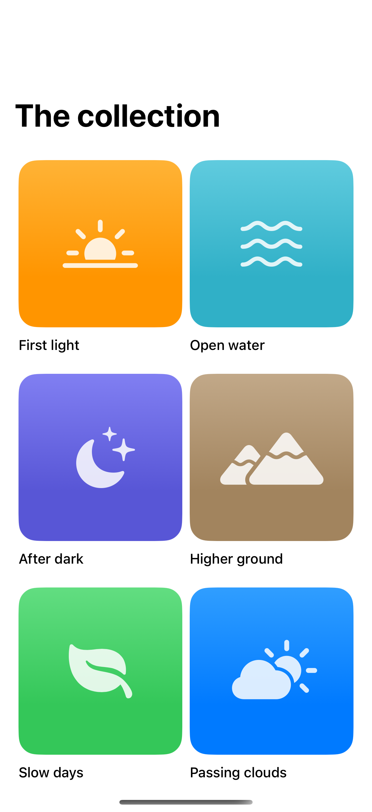
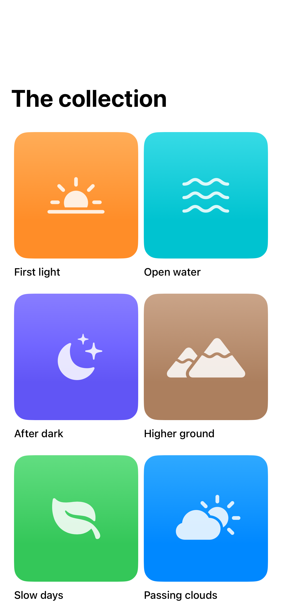

# Grid-to-detail transitions

A matched source connects a selected grid item to its destination with a native zoom transition.

## SwiftUI

```swift
import SwiftUI

struct ZoomingGrid: View {
    @Namespace private var namespace

    var body: some View {
        NavigationStack {
            LazyVGrid(columns: [GridItem(.adaptive(minimum: 120))]) {
                ForEach(0..<6) { id in
                    NavigationLink {
                        Text("Artwork \(id + 1)")
                            .navigationTransition(.zoom(sourceID: id, in: namespace))
                    } label: {
                        Image(systemName: "sun.horizon")
                            .frame(maxWidth: .infinity).frame(height: 150)
                            .background(.orange.opacity(0.2), in: .rect(cornerRadius: 20))
                            .matchedTransitionSource(id: id, in: namespace)
                    }
                }
            }
            .padding()
        }
    }
}
```

## Captures

<!-- captures:start -->
### iPhone 16 Pro · iOS 18.5

default. light appearance; Large text; en_US.



### iPhone 17 Pro · iOS 26.5

default. light appearance; Large text; en_US.


<!-- captures:end -->

## Full example

[Open the complete runnable example](GridDetailTransitionsDemo.swift).

## Reference

[Apple: matchedTransitionSource](https://developer.apple.com/documentation/swiftui/view/matchedtransitionsource(id:in:configuration:)).
