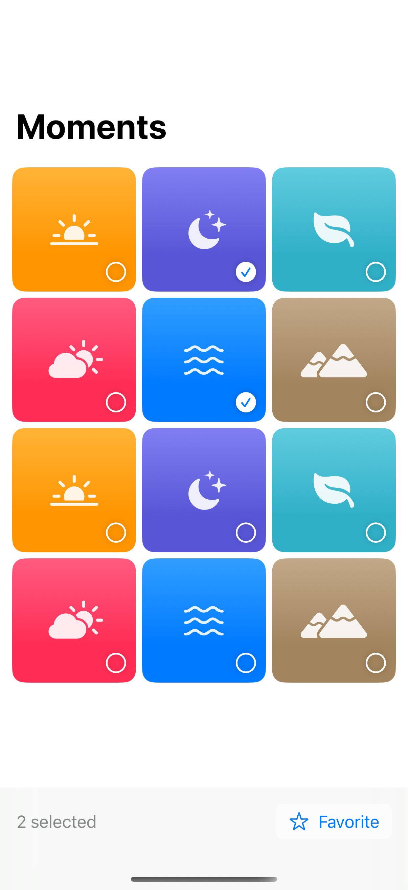
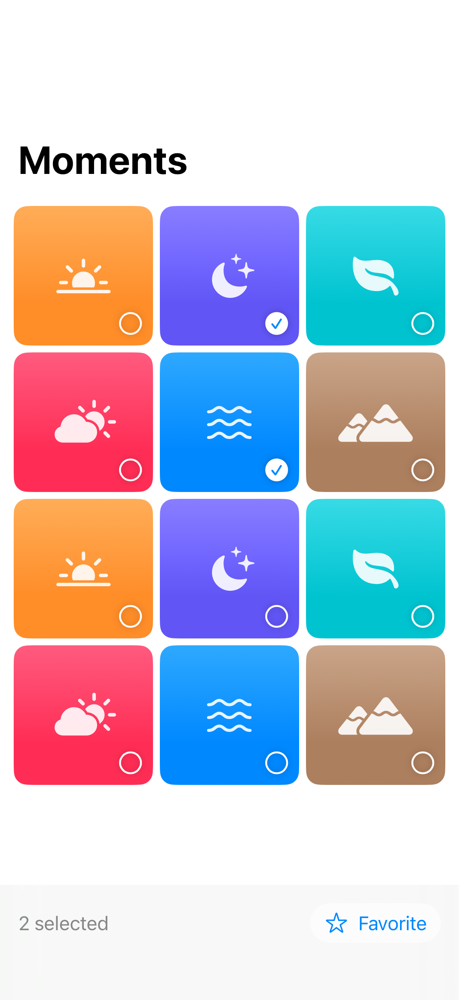

# Selectable artwork grids

Selection overlays keep an image grid compact while supporting individual and batch actions.

## SwiftUI

```swift
import SwiftUI

struct SelectableGrid: View {
    @State private var selected: Set<Int> = []

    var body: some View {
        LazyVGrid(columns: [GridItem(.adaptive(minimum: 100))]) {
            ForEach(0..<12) { id in
                Button {
                    if !selected.insert(id).inserted { selected.remove(id) }
                } label: {
                    Image(systemName: selected.contains(id) ? "checkmark.circle.fill" : "leaf")
                        .frame(maxWidth: .infinity).frame(height: 100)
                        .background(.teal.opacity(0.1), in: .rect(cornerRadius: 12))
                }
                .accessibilityLabel("Artwork \(id + 1)")
                .accessibilityAddTraits(selected.contains(id) ? .isSelected : [])
            }
        }
        .padding()
    }
}
```

## Captures

<!-- captures:start -->
### iPhone 16 Pro · iOS 18.5

default. light appearance; Large text; en_US.



### iPhone 17 Pro · iOS 26.5

default. light appearance; Large text; en_US.


<!-- captures:end -->

## Full example

[Open the complete runnable example](GridSelectionDemo.swift).

## Reference

[Apple: LazyVGrid](https://developer.apple.com/documentation/swiftui/lazyvgrid).
