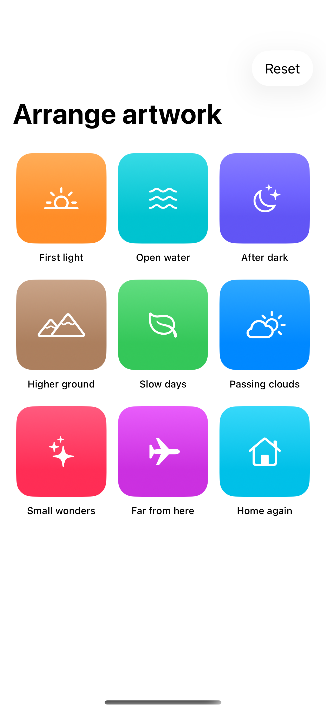
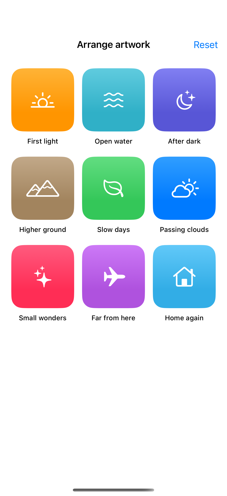

# Reorderable grids

Drag-and-drop destinations can move items within a custom grid while preserving their identity.

## SwiftUI

```swift
import SwiftUI

struct DragReorderingGrid: View {
    @State private var items = ["Sun", "Moon", "Water", "Leaf"]

    var body: some View {
        LazyVGrid(columns: [GridItem(.adaptive(minimum: 120))]) {
            ForEach(items, id: \.self) { item in
                Text(item).frame(maxWidth: .infinity).frame(height: 100)
                    .background(.indigo.opacity(0.1), in: .rect(cornerRadius: 16))
                    .draggable(item)
                    .dropDestination(for: String.self) { values, _ in
                        guard let value = values.first,
                              let source = items.firstIndex(of: value),
                              let destination = items.firstIndex(of: item),
                              source != destination else { return false }
                        withAnimation {
                            items.move(fromOffsets: IndexSet(integer: source), toOffset: source < destination ? destination + 1 : destination)
                        }
                        return true
                    }
            }
        }
    }
}
```

## Captures

<!-- captures:start -->
### iPhone 17 Pro · iOS 26.5

default. light appearance; Large text; en_US.



### iPhone 16 Pro · iOS 18.5

default. light appearance; Large text; en_US.


<!-- captures:end -->

## Full example

[Open the complete runnable example](ReorderableGridDemo.swift).

## Reference

[Apple: dropDestination](https://developer.apple.com/documentation/swiftui/view/dropdestination(for:action:istargeted:)).
