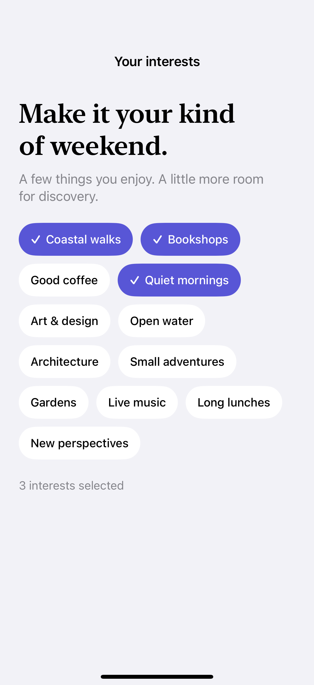
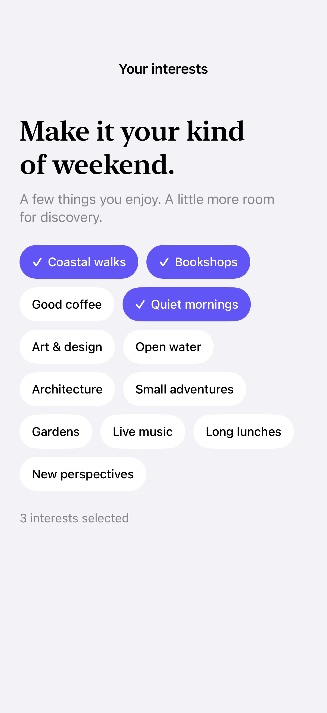

# Wrapping chip layouts

A custom layout flows variable-width items into rows that fit the available space.

## SwiftUI

```swift
import SwiftUI

struct WrappingLayout: Layout {
    var spacing: CGFloat = 8

    private func frames(_ width: CGFloat, _ views: Subviews) -> [CGRect] {
        var x: CGFloat = 0, y: CGFloat = 0, height: CGFloat = 0
        return views.map { view in
            let size = view.sizeThatFits(ProposedViewSize(width: width, height: nil))
            if x > 0 && x + size.width > width { x = 0; y += height + spacing; height = 0 }
            let frame = CGRect(origin: CGPoint(x: x, y: y), size: size)
            x += size.width + spacing
            height = max(height, size.height)
            return frame
        }
    }

    func sizeThatFits(proposal: ProposedViewSize, subviews: Subviews, cache: inout ()) -> CGSize {
        let width = proposal.width ?? subviews.reduce(0) { $0 + $1.sizeThatFits(.unspecified).width + spacing }
        return CGSize(width: width, height: frames(width, subviews).map(\.maxY).max() ?? 0)
    }

    func placeSubviews(in bounds: CGRect, proposal: ProposedViewSize, subviews: Subviews, cache: inout ()) {
        for (view, frame) in zip(subviews, frames(bounds.width, subviews)) {
            view.place(at: CGPoint(x: bounds.minX + frame.minX, y: bounds.minY + frame.minY),
                       anchor: .topLeading, proposal: ProposedViewSize(frame.size))
        }
    }
}

struct WrappedTags: View {
    var body: some View {
        WrappingLayout {
            ForEach(["Coastal walks", "Bookshops", "Good coffee"], id: \.self) {
                Text($0).padding().background(.quaternary, in: .capsule)
            }
        }
    }
}
```

## Captures

<!-- captures:start -->
### iPhone 16 Pro · iOS 18.5

default. light appearance; Large text; en_US.



### iPhone 17 Pro · iOS 26.5

default. light appearance; Large text; en_US.


### iPhone 18 Pro · iOS 27.0

default. light appearance; Large text; en_US.


<!-- captures:end -->

## Full example

[Open the complete runnable example](WrappingChipLayoutDemo.swift).

## Reference

[Apple: Layout](https://developer.apple.com/documentation/swiftui/layout).
