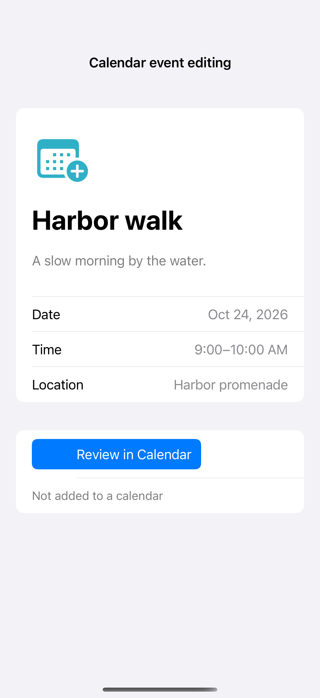

# Calendar event editing

EKEventEditViewController lets someone review, edit, and save a proposed event in native Calendar UI. On iOS 17 and later this editor works without requesting calendar access; the app supplies the proposal and receives a completion action, without reading the person’s calendars. Opening or saving occurs only through manual controls.

## SwiftUI

```swift
import SwiftUI
import EventKitUI

struct CalendarRecipe: View {
    @State private var presented = false
    var body: some View {
        Button("Review calendar event") { presented = true }
            .sheet(isPresented: $presented) { EventEditor { presented = false } }
    }
}
private struct EventEditor: UIViewControllerRepresentable {
    var finished: () -> Void
    func makeCoordinator() -> Coordinator { Coordinator(finished) }
    func makeUIViewController(context: Context) -> EKEventEditViewController {
        let store = EKEventStore()
        let event = EKEvent(eventStore: store)
        event.title = "Harbor walk"; event.startDate = Date().addingTimeInterval(3600)
        event.endDate = event.startDate.addingTimeInterval(3600)
        let controller = EKEventEditViewController()
        controller.eventStore = store; controller.event = event; controller.editViewDelegate = context.coordinator
        return controller
    }
    func updateUIViewController(_ controller: EKEventEditViewController, context: Context) {}
    final class Coordinator: NSObject, EKEventEditViewDelegate {
        let finished: () -> Void
        init(_ finished: @escaping () -> Void) { self.finished = finished }
        func eventEditViewController(_ controller: EKEventEditViewController, didCompleteWith action: EKEventEditViewAction) { finished() }
    }
}
```

## Captures

<!-- captures:start -->
### iPhone 16 Pro · iOS 18.5

default. light appearance; Large text; en_US.


<!-- captures:end -->

## Full example

[Open the complete runnable example](CalendarEventEditorDemo.swift).

## Reference

[Apple: EventKit and EventKitUI access](https://developer.apple.com/documentation/eventkit/accessing-calendar-using-eventkit-and-eventkitui).
