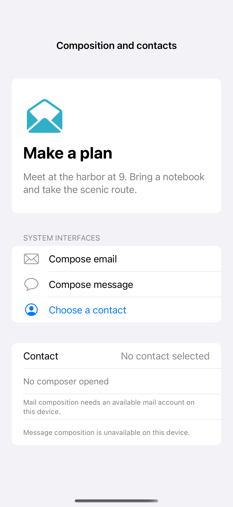

# Mail, messages, and contact selection

Native mail and message composers keep sending under the user’s control, and a contact picker returns only the contact they choose without requesting address-book access. Availability checks disable unsupported composers; these manual flows never run during captures and do not prefill a recipient.

## SwiftUI

```swift
import SwiftUI
import ContactsUI

struct ContactPickerRecipe: View {
    @State private var presented = false
    @State private var name = "No contact selected"
    var body: some View {
        VStack(spacing: 20) {
            Text(name)
            Button("Choose a contact") { presented = true }
        }
        .sheet(isPresented: $presented) {
            ContactPicker { selected in
                if let selected { name = selected }
                presented = false
            }
        }
    }
}

private struct ContactPicker: UIViewControllerRepresentable {
    var selected: (String?) -> Void
    func makeCoordinator() -> Coordinator { Coordinator(selected: selected) }
    func makeUIViewController(context: Context) -> CNContactPickerViewController {
        let controller = CNContactPickerViewController(); controller.delegate = context.coordinator; return controller
    }
    func updateUIViewController(_ controller: CNContactPickerViewController, context: Context) {}
    final class Coordinator: NSObject, CNContactPickerDelegate {
        let selected: (String?) -> Void
        init(selected: @escaping (String?) -> Void) { self.selected = selected }
        func contactPicker(_ picker: CNContactPickerViewController, didSelect contact: CNContact) {
            selected(CNContactFormatter.string(from: contact, style: .fullName) ?? "Contact selected")
        }
        func contactPickerDidCancel(_ picker: CNContactPickerViewController) { selected(nil) }
    }
}
```

## Captures

<!-- captures:start -->
### iPhone 16 Pro · iOS 18.5

default. light appearance; Large text; en_US.


<!-- captures:end -->

## Full example

[Open the complete runnable example](CompositionContactsDemo.swift).

## Reference

[Apple: CNContactPickerViewController](https://developer.apple.com/documentation/contactsui/cncontactpickerviewcontroller).
