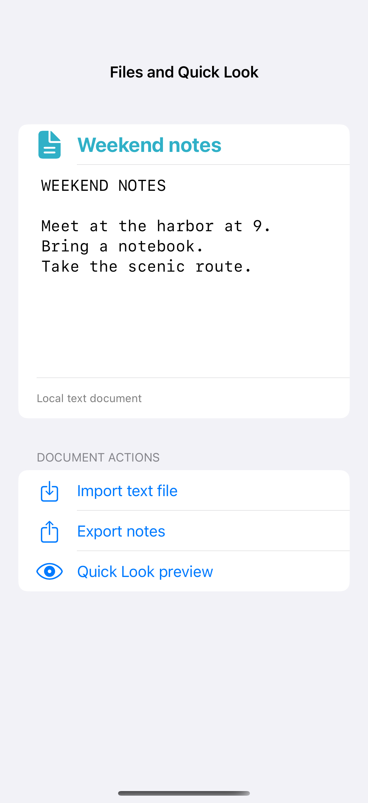

# Files and Quick Look

File importers and exporters use the system document interface, while Quick Look previews a local file with native controls. This example starts with a small text fixture and balances security-scoped access when importing. Dedicated document-browser entry screens are not included; a document-based app launch also requires an app-level DocumentGroup scene.

## SwiftUI

```swift
import SwiftUI
import UniformTypeIdentifiers

struct TextFileRecipe: View {
    @State private var exporting = false
    @State private var result = "Ready"
    var body: some View {
        VStack(spacing: 20) {
            Button("Export notes") { exporting = true }
            Text(result)
        }
        .fileExporter(isPresented: $exporting, document: NotesDocument(), contentType: .plainText, defaultFilename: "Weekend notes") {
            switch $0 { case .success: result = "Exported"; case .failure: result = "Export cancelled or failed" }
        }
    }
}

private struct NotesDocument: FileDocument {
    static var readableContentTypes: [UTType] { [.plainText] }
    var text = "Meet at the harbor at 9."
    init() {}
    init(configuration: ReadConfiguration) throws {
        text = String(decoding: configuration.file.regularFileContents ?? Data(), as: UTF8.self)
    }
    func fileWrapper(configuration: WriteConfiguration) throws -> FileWrapper {
        FileWrapper(regularFileWithContents: Data(text.utf8))
    }
}
```

## Captures

<!-- captures:start -->
### iPhone 16 Pro · iOS 18.5

default. light appearance; Large text; en_US.


<!-- captures:end -->

## Full example

[Open the complete runnable example](FilesQuickLookDemo.swift).

## Reference

[Apple: FileDocument](https://developer.apple.com/documentation/swiftui/filedocument).
