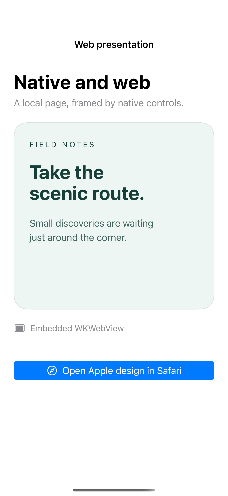

# Web views and browser presentation

WKWebView embeds web content within a native layout, while SFSafariViewController offers browser controls for a destination the user opens. The embedded page here is a local HTML fixture with no network requests; the public Apple design page opens only from the browser button.

## SwiftUI

```swift
import SwiftUI
import SafariServices

struct SafariRecipe: View {
    @State private var presented = false
    var body: some View {
        Button("Open Apple design") { presented = true }
            .sheet(isPresented: $presented) { SafariPage() }
    }
}

private struct SafariPage: UIViewControllerRepresentable {
    func makeUIViewController(context: Context) -> SFSafariViewController {
        SFSafariViewController(url: URL(string: "https://developer.apple.com/design/")!)
    }
    func updateUIViewController(_ controller: SFSafariViewController, context: Context) {}
}
```

## Captures

<!-- captures:start -->
### iPhone 16 Pro · iOS 18.5

default. light appearance; Large text; en_US.


<!-- captures:end -->

## Full example

[Open the complete runnable example](NativeWebPresentationDemo.swift).

## Reference

[Apple: SFSafariViewController](https://developer.apple.com/documentation/safariservices/sfsafariviewcontroller).
