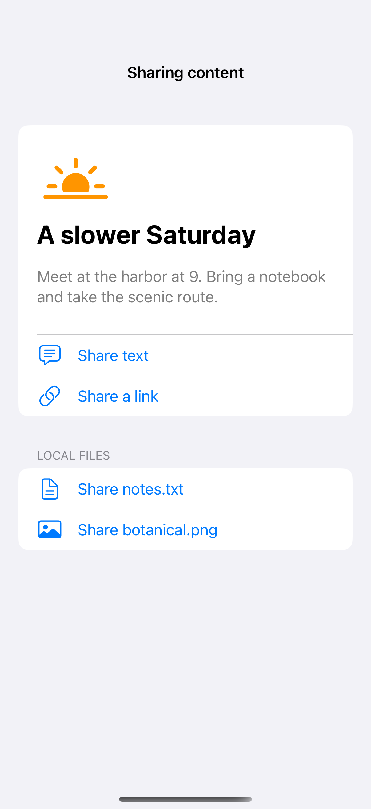

# Sharing text, links, and files

ShareLink presents the system sharing interface for transferable content, with an optional title and preview image. These examples offer a short note, a public link, and locally generated text and image files; nothing is shared until someone chooses a destination and completes its system flow.

## SwiftUI

```swift
import SwiftUI

struct SharingRecipe: View {
    var body: some View {
        VStack(spacing: 24) {
            ShareLink(item: "Meet at the harbor at 9.", subject: Text("Weekend plans")) {
                Label("Share note", systemImage: "square.and.arrow.up")
            }
            ShareLink(item: URL(string: "https://developer.apple.com/design/")!) {
                Label("Share design link", systemImage: "link")
            }
        }.padding()
    }
}
```

## Captures

<!-- captures:start -->
### iPhone 16 Pro · iOS 18.5

default. light appearance; Large text; en_US.


<!-- captures:end -->

## Full example

[Open the complete runnable example](SharingContentDemo.swift).

## Reference

[Apple: ShareLink](https://developer.apple.com/documentation/swiftui/sharelink).
