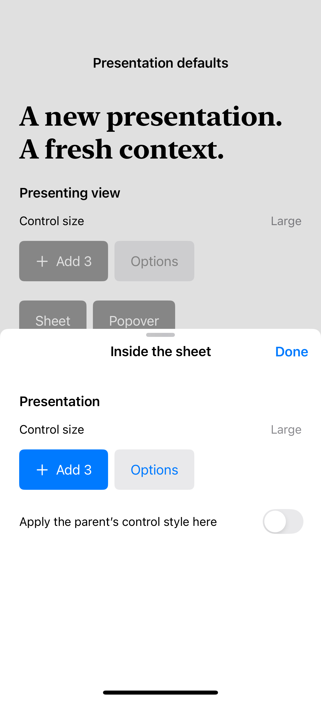

# Control environments in presentations

A presentation can establish different control defaults from the view that presents it.

## SwiftUI

```swift
import SwiftUI

struct SheetControlProbe: View {
    @State private var presented = false
    var body: some View {
        Button("Open sheet") { presented = true }
            .sheet(isPresented: $presented) { ControlSizeReadout() }
            .controlSize(.large)
    }
}

struct ControlSizeReadout: View {
    @Environment(\.controlSize) private var size
    var body: some View {
        VStack {
            Text("Control size: \(String(describing: size))")
            Button("Example") {}.buttonStyle(.borderedProminent)
        }
    }
}
```

## Captures

<!-- captures:start -->
### iPhone 16 Pro · iOS 18.5

default. light appearance; Large text; en_US.


<!-- captures:end -->

## Example notes

Apple’s iOS 27 release notes describe an SDK-linked fix that resets controlSize, buttonSizing, buttonRepeatBehavior, menuIndicatorVisibility, and ButtonBorderShape in sheets and popovers. This probe sets those values on the presenter (buttonSizing only on iOS 26+) and can reapply them explicitly inside either presentation. Its readouts report observed environment values, not an assumed outcome. The atlas’s same-SDK runtime captures cannot isolate the effect of linking an older SDK. No affected-version regression or successful workaround is asserted without the corresponding builds and interaction checks.

## Full example

[Open the complete runnable example](PresentationControlEnvironmentDemo.swift).

## Reference

[Apple documentation](https://developer.apple.com/documentation/ios-ipados-release-notes/ios-ipados-27-release-notes).
