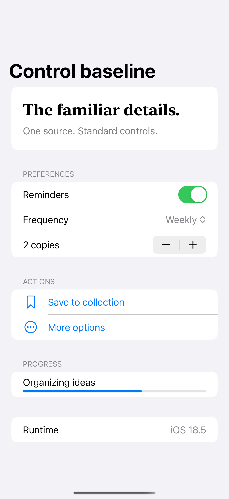

# Default controls across runtimes

A stable screen of standard controls provides a baseline for captures from different iOS runtimes.

## SwiftUI

```swift
import SwiftUI

struct RuntimeControlSample: View {
    @State private var enabled = true
    @State private var count = 2
    var body: some View {
        Form {
            Toggle("Reminders", isOn: $enabled)
            Stepper("\(count) copies", value: $count, in: 1...5)
            Button("Reset") { enabled = true; count = 2 }
            ProgressView(value: 0.65)
        }
    }
}
```

## Captures

<!-- captures:start -->
### iPhone 16 Pro · iOS 18.5

default. light appearance; Large text; en_US.


<!-- captures:end -->

## Example notes

Keep source, content state, device, appearance, and build SDK matched when comparing runtime captures. This screen does not force custom button, toggle, or form styles. Captures record exact runtime and build provenance in their manifests. A single build on iOS 18, 26, and 27 shows runtime differences for that SDK; it cannot establish SDK-linking behavior, beta-to-release changes, animation behavior, or a regression.

## Full example

[Open the complete runnable example](RuntimeControlBaselineDemo.swift).

## Reference

[Apple documentation](https://developer.apple.com/documentation/swiftui).
