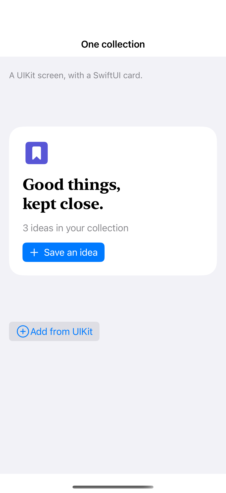

# SwiftUI inside a UIKit controller

A UIHostingController embeds a SwiftUI view using UIKit’s normal child-controller lifecycle.

## SwiftUI

```swift
import SwiftUI
import UIKit

@MainActor
final class HostingContainer: UIViewController {
    override func viewDidLoad() {
        super.viewDidLoad()
        let host = UIHostingController(rootView: Text("Hello from SwiftUI").font(.title))
        addChild(host)
        host.view.translatesAutoresizingMaskIntoConstraints = false
        view.addSubview(host.view)
        NSLayoutConstraint.activate([
            host.view.leadingAnchor.constraint(equalTo: view.safeAreaLayoutGuide.leadingAnchor),
            host.view.trailingAnchor.constraint(equalTo: view.safeAreaLayoutGuide.trailingAnchor),
            host.view.topAnchor.constraint(equalTo: view.safeAreaLayoutGuide.topAnchor),
            host.view.bottomAnchor.constraint(equalTo: view.safeAreaLayoutGuide.bottomAnchor)
        ])
        host.didMove(toParent: self)
    }
}
```

## Captures

<!-- captures:start -->
### iPhone 16 Pro · iOS 18.5

default. light appearance; Large text; en_US.


<!-- captures:end -->

## Example notes

The outer example uses UIViewControllerRepresentable to display a UIKit container. That controller embeds a real UIHostingController as a child. Both native and hosted buttons update the same SwiftUI state. This example forwards its model explicitly; it does not claim arbitrary SwiftUI environment values cross newly created hosting roots automatically.

## Full example

[Open the complete runnable example](SwiftUIInUIKitDemo.swift).

## Reference

[Apple documentation](https://developer.apple.com/documentation/swiftui/uihostingcontroller).
