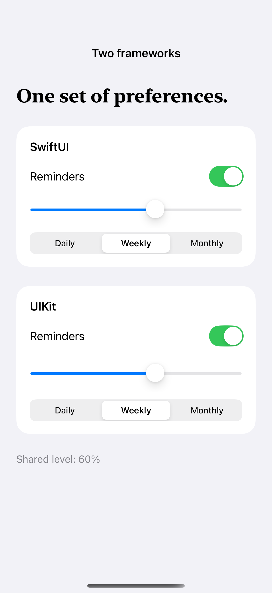

# Equivalent UIKit and SwiftUI controls

The same bindings drive native controls from both frameworks for a direct appearance and interaction comparison.

## SwiftUI

```swift
import SwiftUI
import UIKit

struct NativeSwitch: UIViewRepresentable {
    @Binding var isOn: Bool
    func makeCoordinator() -> Coordinator { Coordinator($isOn) }
    func makeUIView(context: Context) -> UISwitch {
        let control = UISwitch()
        control.addTarget(context.coordinator, action: #selector(Coordinator.changed(_:)), for: .valueChanged)
        return control
    }
    func updateUIView(_ control: UISwitch, context: Context) {
        context.coordinator.value = $isOn
        control.isOn = isOn
    }
    @MainActor final class Coordinator: NSObject {
        var value: Binding<Bool>
        init(_ value: Binding<Bool>) { self.value = value }
        @objc func changed(_ sender: UISwitch) { value.wrappedValue = sender.isOn }
    }
}
```

## Captures

<!-- captures:start -->
### iPhone 16 Pro · iOS 18.5

default. light appearance; Large text; en_US.


<!-- captures:end -->

## Example notes

The pairs share real state, so either framework can change both controls. A difference in a capture demonstrates that runtime and configuration only; equivalent purpose does not imply identical implementation or pixel geometry.

## Full example

[Open the complete runnable example](UIKitSwiftUIControlsDemo.swift).

## Reference

[Apple documentation](https://developer.apple.com/documentation/swiftui/uiviewrepresentable).
