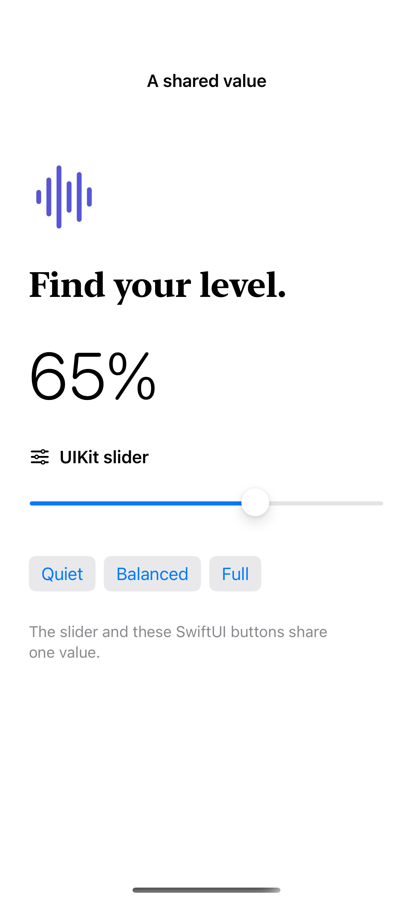

# Two-way UIKit bindings

A coordinator carries UIKit target-action changes back into SwiftUI state.

## SwiftUI

```swift
import SwiftUI
import UIKit

struct BoundUIKitSlider: UIViewRepresentable {
    @Binding var value: Float
    func makeCoordinator() -> Coordinator { Coordinator($value) }
    func makeUIView(context: Context) -> UISlider {
        let slider = UISlider()
        slider.addTarget(context.coordinator, action: #selector(Coordinator.changed(_:)), for: .valueChanged)
        return slider
    }
    func updateUIView(_ slider: UISlider, context: Context) {
        context.coordinator.value = $value
        slider.value = value
    }
    @MainActor final class Coordinator: NSObject {
        var value: Binding<Float>
        init(_ value: Binding<Float>) { self.value = value }
        @objc func changed(_ slider: UISlider) { value.wrappedValue = slider.value }
    }
}
```

## Captures

<!-- captures:start -->
### iPhone 16 Pro · iOS 18.5

default. light appearance; Large text; en_US.


<!-- captures:end -->

## Example notes

Changing the native slider updates the SwiftUI percentage; the three SwiftUI buttons update that same slider. The representable refreshes its coordinator binding during updates and removes its target on teardown. No UIKit frame is assigned by the wrapper.

## Full example

[Open the complete runnable example](UIViewBindingBridgeDemo.swift).

## Reference

[Apple documentation](https://developer.apple.com/documentation/swiftui/uiviewrepresentable).
