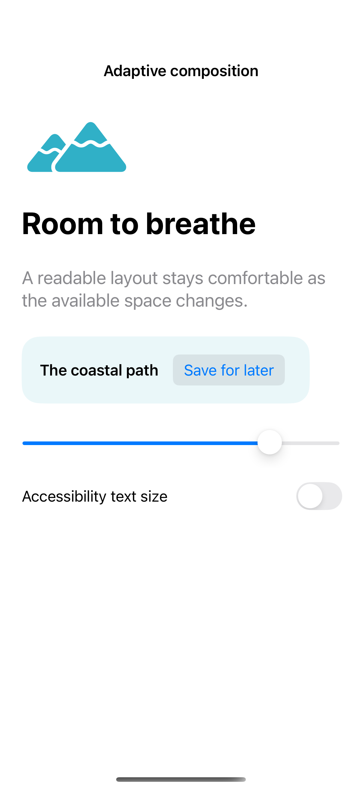
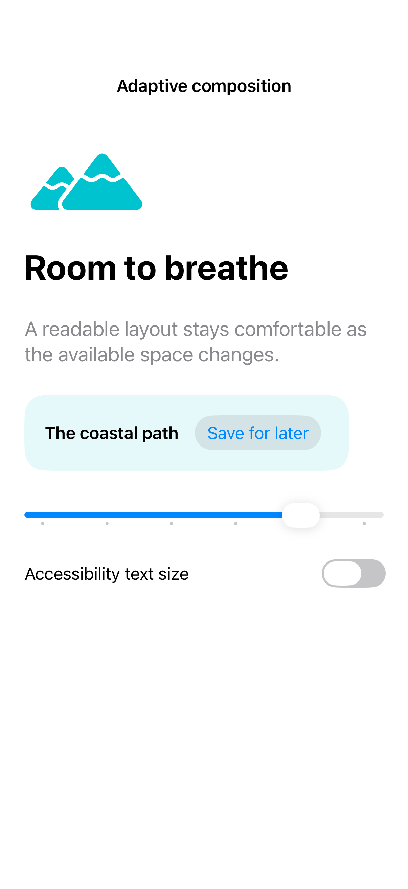

# Adaptive composition

ViewThatFits selects the first child that fits the available space. Combine that with a readable maximum width and explicit accessibility-size layouts so larger text changes the arrangement instead of squeezing important controls.

## SwiftUI

```swift
import SwiftUI

struct AdaptiveCompositionRecipe: View {
    @State private var saved = false
    var body: some View {
        ViewThatFits(in: .horizontal) {
            HStack {
                Text("The coastal path").font(.headline)
                Button(saved ? "Saved" : "Save for later") { saved.toggle() }
            }.fixedSize()
            VStack(alignment: .leading) {
                Text("The coastal path").font(.headline)
                Button(saved ? "Saved" : "Save for later") { saved.toggle() }
            }
        }
        .padding()
    }
}
```

## Captures

<!-- captures:start -->
### iPhone 16 Pro · iOS 18.5

default. light appearance; Large text; en_US.



### iPhone 17 Pro · iOS 26.5

default. light appearance; Large text; en_US.


<!-- captures:end -->

## Full example

[Open the complete runnable example](AdaptiveCompositionDemo.swift).

## Reference

[Apple: layout](https://developer.apple.com/design/human-interface-guidelines/layout).
