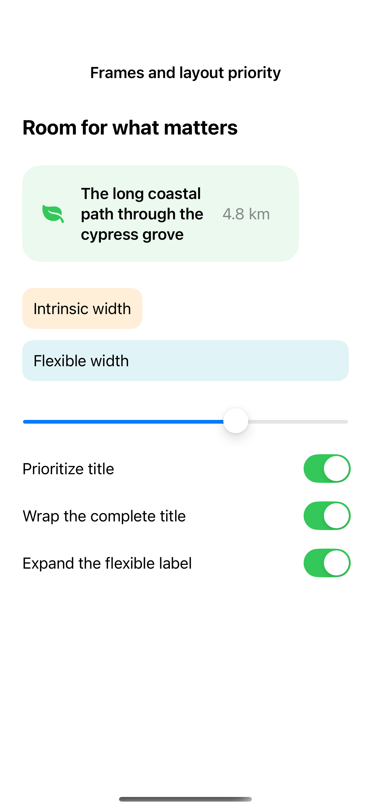
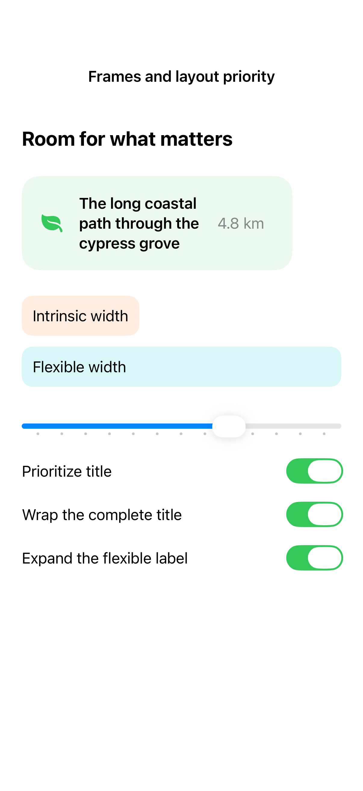

# Frames and layout priority

A frame changes the space offered to a view, while layout priority influences how siblings share limited room. Fixed-size behavior can preserve intrinsic content where truncation would hide something important.

## SwiftUI

```swift
import SwiftUI

struct LayoutPriorityRecipe: View {

    var body: some View {
        HStack(spacing: 16) {
            Text("The long coastal path").layoutPriority(1)
            Text("4.8 km").fixedSize()
        }
        .frame(maxWidth: .infinity, alignment: .leading)
        .padding()
    }
}
```

## Captures

<!-- captures:start -->
### iPhone 16 Pro · iOS 18.5

default. light appearance; Large text; en_US.



### iPhone 17 Pro · iOS 26.5

default. light appearance; Large text; en_US.


<!-- captures:end -->

## Full example

[Open the complete runnable example](FlexibleFramesDemo.swift).

## Reference

[Apple: layout](https://developer.apple.com/design/human-interface-guidelines/layout).
