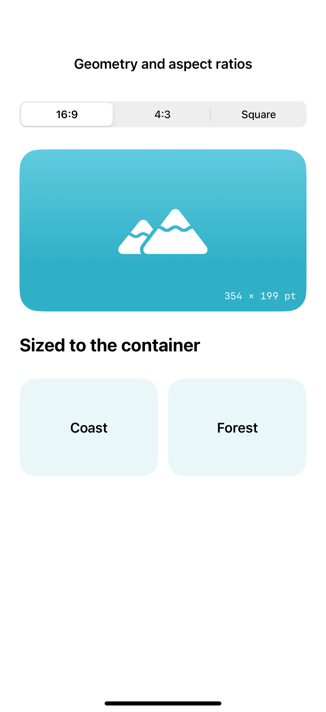
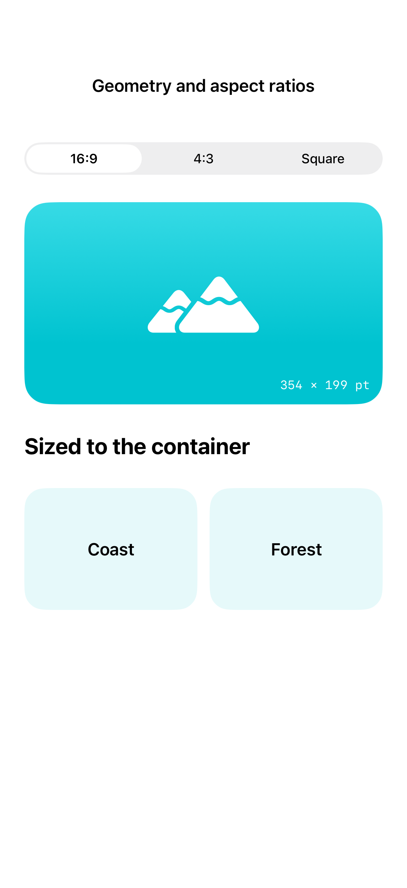

# Geometry and aspect ratios

GeometryReader reports a container’s actual size, aspect ratio preserves a chosen proportion, and container-relative frames size repeated content against its surrounding container. These tools help layouts adapt without assuming a particular device width.

## SwiftUI

```swift
import SwiftUI

struct AspectRatioRecipe: View {

    var body: some View {
        RoundedRectangle(cornerRadius: 24)
            .fill(.teal.gradient)
            .aspectRatio(16.0 / 9.0, contentMode: .fit)
            .overlay {
                Image(systemName: "mountain.2.fill").font(.largeTitle).foregroundStyle(.white)
            }
            .padding()
    }
}
```

## Captures

<!-- captures:start -->
### iPhone 16 Pro · iOS 18.5

default. light appearance; Large text; en_US.



### iPhone 17 Pro · iOS 26.5

default. light appearance; Large text; en_US.


<!-- captures:end -->

## Full example

[Open the complete runnable example](GeometryAspectDemo.swift).

## Reference

[Apple: layout](https://developer.apple.com/design/human-interface-guidelines/layout).
