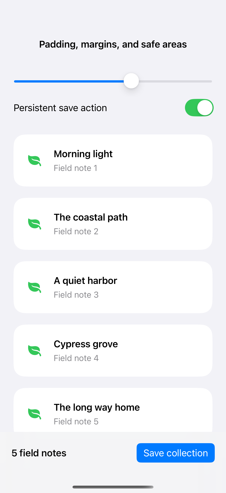
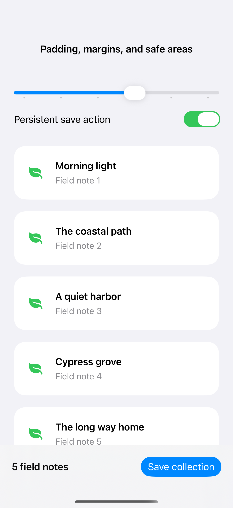

# Padding, margins, and safe areas

Padding belongs to a view, content margins belong to a scroll container, and safe-area insets reserve room for surrounding interface. Combining them lets content scroll comfortably above a persistent action without hiding its final items.

## SwiftUI

```swift
import SwiftUI

struct SafeAreaLayoutRecipe: View {

    var body: some View {
        ScrollView {
            LazyVStack(spacing: 16) {
                ForEach(1...8, id: \.self) { Text("Field note \($0)").frame(maxWidth: .infinity).padding(24) }
            }
        }
        .contentMargins(.horizontal, 24, for: .scrollContent)
        .safeAreaInset(edge: .bottom) {
            Text("8 saved notes").padding().frame(maxWidth: .infinity).background(.regularMaterial)
        }
    }
}
```

## Captures

<!-- captures:start -->
### iPhone 16 Pro · iOS 18.5

default. light appearance; Large text; en_US.



### iPhone 17 Pro · iOS 26.5

default. light appearance; Large text; en_US.


<!-- captures:end -->

## Full example

[Open the complete runnable example](LayoutInsetsDemo.swift).

## Reference

[Apple: layout](https://developer.apple.com/design/human-interface-guidelines/layout).
