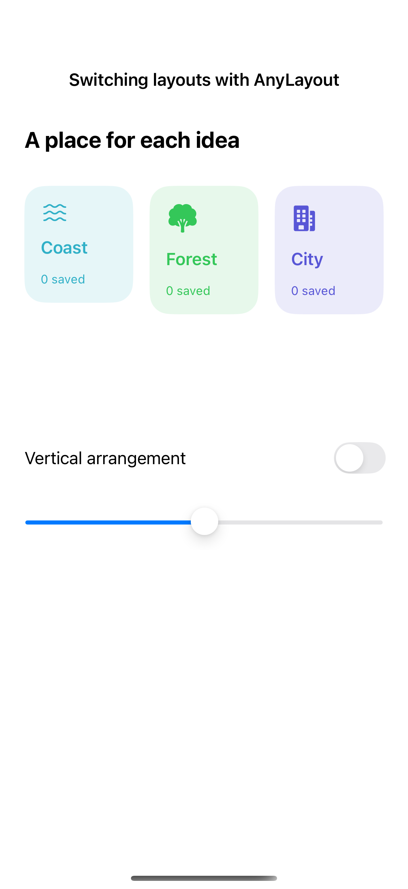
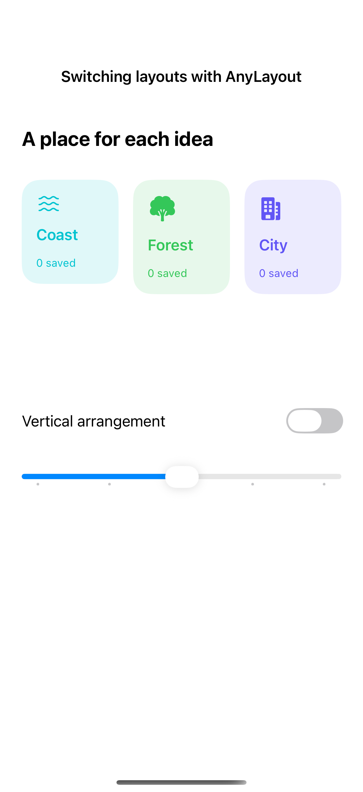
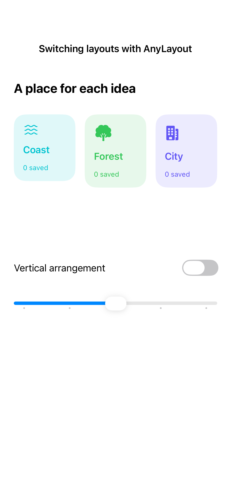

# Switching layouts with AnyLayout

AnyLayout changes the layout algorithm while retaining the identity of its child views. This preserves local state as the arrangement changes; the app demonstrates the transition, while a capture shows one resting arrangement.

## SwiftUI

```swift
import SwiftUI

struct AnyLayoutRecipe: View {
    @Environment(\.accessibilityReduceMotion) private var reduceMotion
    @State private var vertical = false
    var body: some View {
        let layout = vertical ? AnyLayout(VStackLayout(spacing: 16)) : AnyLayout(HStackLayout(spacing: 16))
        VStack(spacing: 24) {
            layout {
                Image(systemName: "leaf.fill")
                Text("Weekend references")
            }
            Toggle("Vertical layout", isOn: $vertical)
        }
        .animation(reduceMotion ? nil : .smooth, value: vertical)
    }
}
```

## Captures

<!-- captures:start -->
### iPhone 16 Pro · iOS 18.5

default. light appearance; Large text; en_US.



### iPhone 17 Pro · iOS 26.5

default. light appearance; Large text; en_US.



### iPhone 18 Pro · iOS 27.0

default. light appearance; Large text; en_US.


<!-- captures:end -->

## Full example

[Open the complete runnable example](LayoutSwitchingDemo.swift).

## Reference

[Apple: layout](https://developer.apple.com/design/human-interface-guidelines/layout).
