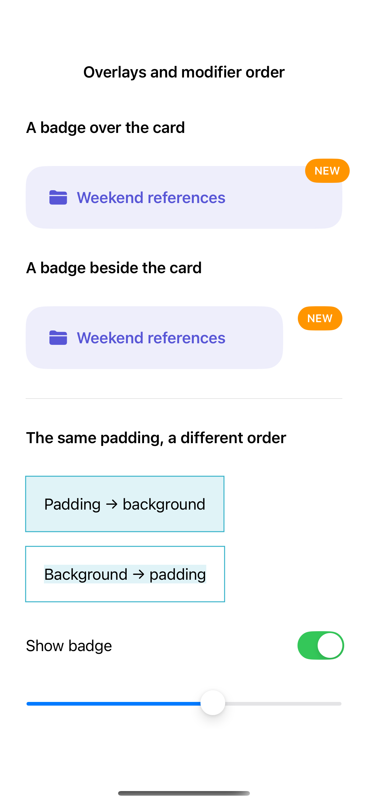
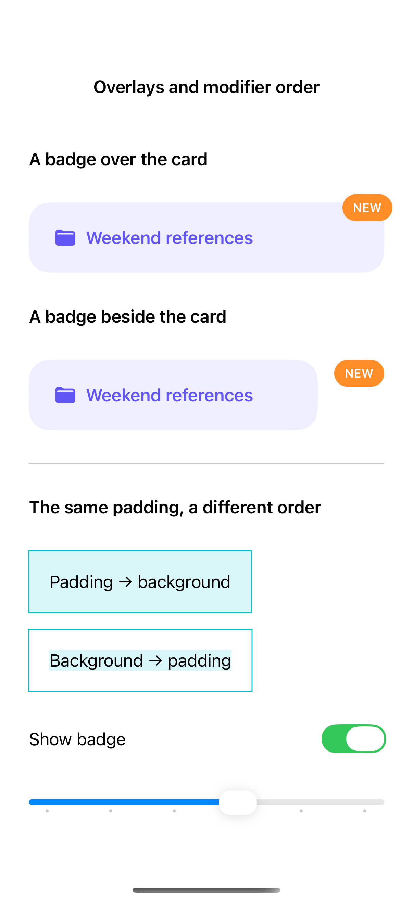

# Overlays and modifier order

An overlay decorates a view without taking space beside it, while a stack makes each child part of the layout. Modifier order also changes which bounds a background or border sees, so the same padding can produce a different visual result.

## SwiftUI

```swift
import SwiftUI

struct ModifierOrderRecipe: View {

    var body: some View {
        VStack(spacing: 24) {
            Text("Padding first")
                .padding(20)
                .background(.teal.opacity(0.15))
            Text("Background first")
                .background(.teal.opacity(0.15))
                .padding(20)
        }
    }
}
```

## Captures

<!-- captures:start -->
### iPhone 16 Pro · iOS 18.5

default. light appearance; Large text; en_US.



### iPhone 17 Pro · iOS 26.5

default. light appearance; Large text; en_US.


<!-- captures:end -->

## Full example

[Open the complete runnable example](OverlayModifierOrderDemo.swift).

## Reference

[Apple: layout](https://developer.apple.com/design/human-interface-guidelines/layout).
