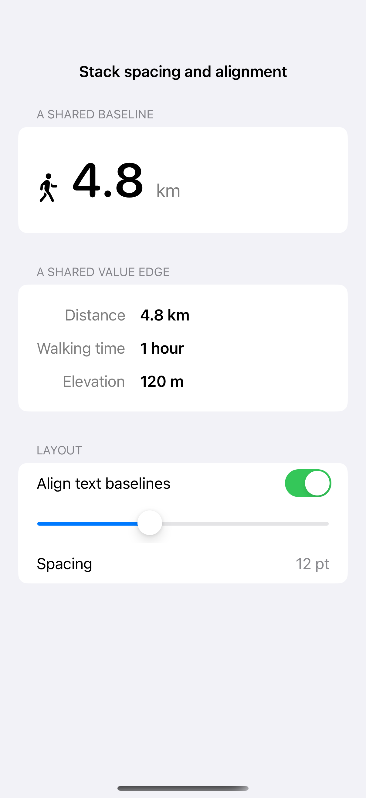
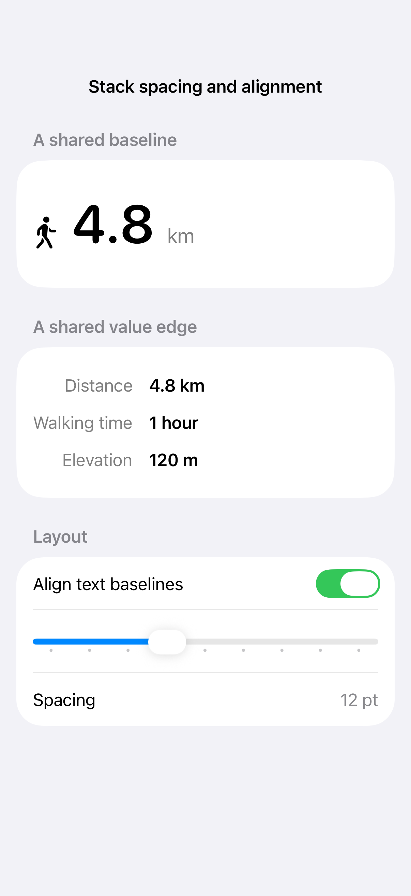

# Stack spacing and alignment

Stacks arrange content along one axis while alignment guides position it along the other. Text baselines keep mixed type sizes coherent, and a custom guide can align related values across separate rows.

## SwiftUI

```swift
import SwiftUI

struct BaselineRecipe: View {

    var body: some View {
        HStack(alignment: .firstTextBaseline, spacing: 8) {
            Text("4.8").font(.system(size: 52, weight: .semibold))
            Text("km").font(.title3).foregroundStyle(.secondary)
        }
    }
}
```

## Captures

<!-- captures:start -->
### iPhone 16 Pro · iOS 18.5

default. light appearance; Large text; en_US.



### iPhone 17 Pro · iOS 26.5

default. light appearance; Large text; en_US.


<!-- captures:end -->

## Full example

[Open the complete runnable example](StackAlignmentDemo.swift).

## Reference

[Apple: layout](https://developer.apple.com/design/human-interface-guidelines/layout).
