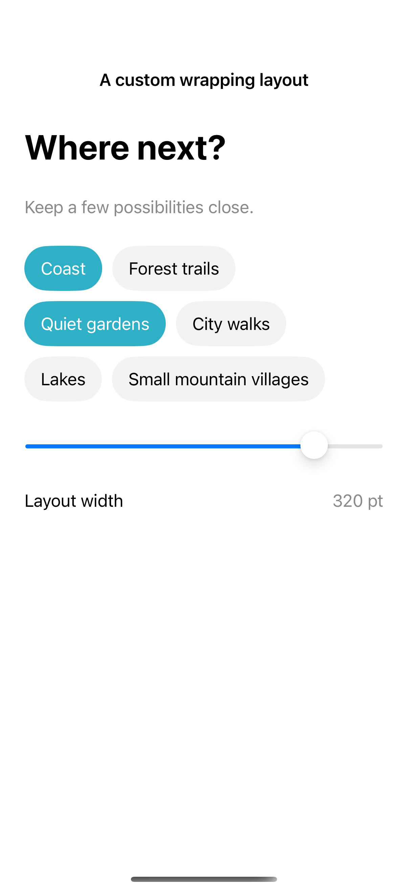
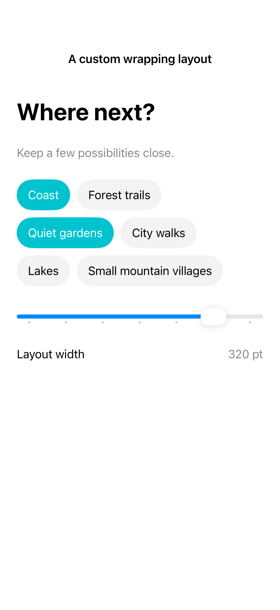

# A custom wrapping layout

A custom Layout measures its children and places them within the proposed space. This flow layout starts a new row when the next item no longer fits and remeasures long labels at the available width so they can wrap.

## SwiftUI

```swift
import SwiftUI

struct FlowLayoutRecipe: View {
    var body: some View {
        RecipeFlowLayout {
            ForEach(["Coast", "Forest", "A quiet garden"], id: \.self) {
                Text($0).padding(12).background(.teal.opacity(0.12), in: Capsule())
            }
        }.padding()
    }
}

private struct RecipeFlowLayout: Layout {
    var spacing: CGFloat = 10
    func sizeThatFits(proposal: ProposedViewSize, subviews: Subviews, cache: inout ()) -> CGSize {
        arrange(subviews, width: proposal.width).size
    }
    func placeSubviews(in bounds: CGRect, proposal: ProposedViewSize, subviews: Subviews, cache: inout ()) {
        let result = arrange(subviews, width: bounds.width)
        for index in subviews.indices {
            subviews[index].place(at: CGPoint(x: bounds.minX + result.points[index].x,
                                              y: bounds.minY + result.points[index].y),
                                  anchor: .topLeading,
                                  proposal: ProposedViewSize(result.sizes[index]))
        }
    }
    private func arrange(_ subviews: Subviews, width: CGFloat?) -> (size: CGSize, points: [CGPoint], sizes: [CGSize]) {
        let ideal = subviews.map { $0.sizeThatFits(.unspecified) }
        let naturalWidth = ideal.reduce(0) { $0 + $1.width } + spacing * CGFloat(max(0, ideal.count - 1))
        let available = max(0, width?.isFinite == true ? width! : naturalWidth)
        var points: [CGPoint] = []
        var sizes: [CGSize] = []
        var x: CGFloat = 0
        var y: CGFloat = 0
        var rowHeight: CGFloat = 0
        for (index, view) in subviews.enumerated() {
            let size = view.sizeThatFits(ProposedViewSize(width: min(ideal[index].width, available), height: nil))
            if x > 0 && x + size.width > available {
                x = 0; y += rowHeight + spacing; rowHeight = 0
            }
            points.append(CGPoint(x: x, y: y)); sizes.append(size)
            x += size.width + spacing
            rowHeight = max(rowHeight, size.height)
        }
        return (CGSize(width: available, height: y + rowHeight), points, sizes)
    }
}
```

## Captures

<!-- captures:start -->
### iPhone 16 Pro · iOS 18.5

default. light appearance; Large text; en_US.



### iPhone 17 Pro · iOS 26.5

default. light appearance; Large text; en_US.



### iPhone 18 Pro · iOS 27.0

default. light appearance; Large text; en_US.


<!-- captures:end -->

## Full example

[Open the complete runnable example](WrappingLayoutDemo.swift).

## Reference

[Apple: layout](https://developer.apple.com/design/human-interface-guidelines/layout).
