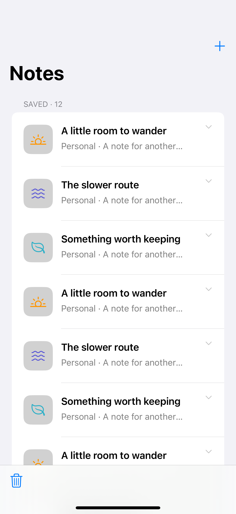
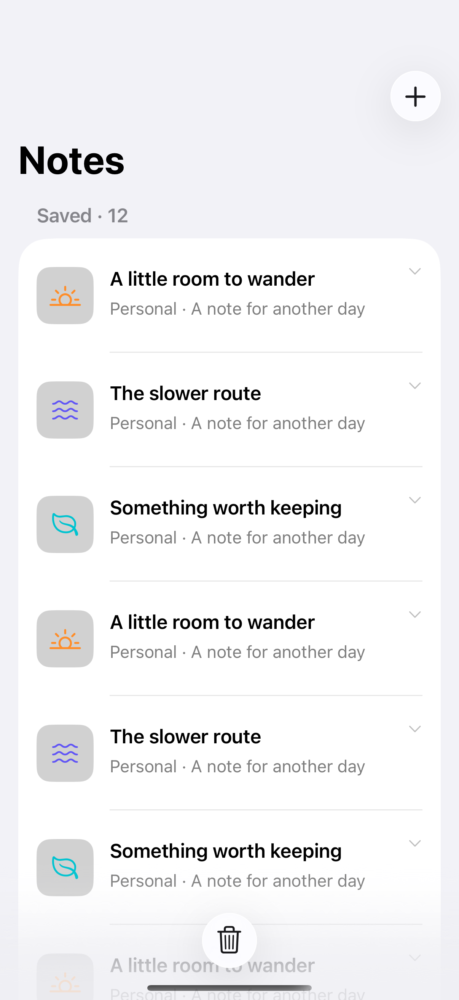
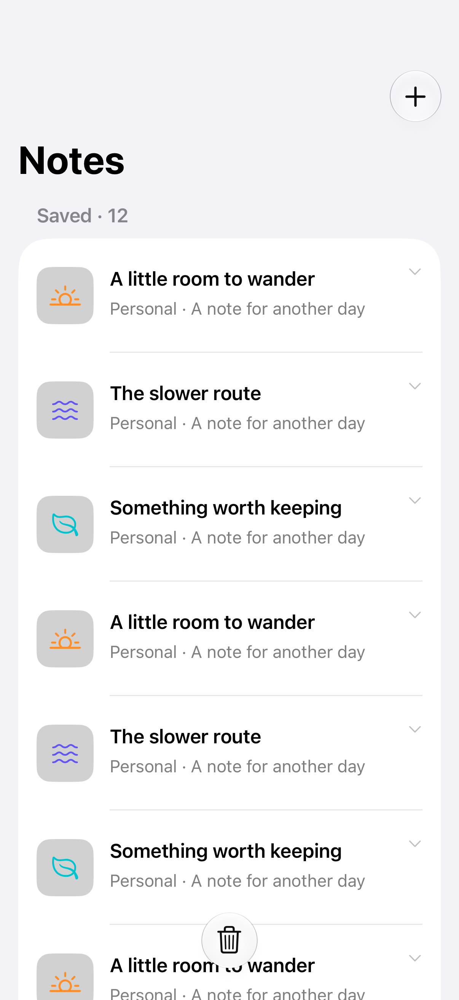

# Animated list updates

Stable row identities let a list animate insertions, removals, and content changes.

## SwiftUI

```swift
import SwiftUI

struct AnimatedNotes: View {
    struct Note: Identifiable { let id = UUID(); let title: String }
    @State private var notes = [Note(title: "A quieter morning")]

    var body: some View {
        List {
            Button("Add note") {
                withAnimation { notes.insert(Note(title: "A new beginning"), at: 0) }
            }
            ForEach(notes) { Text($0.title) }
                .onDelete { offsets in
                    withAnimation { notes.remove(atOffsets: offsets) }
                }
        }
    }
}
```

## Captures

<!-- captures:start -->
### iPhone 16 Pro · iOS 18.5

default. light appearance; Large text; en_US.



### iPhone 17 Pro · iOS 26.5

default. light appearance; Large text; en_US.



### iPhone 18 Pro · iOS 27.0

default. light appearance; Large text; en_US.


<!-- captures:end -->

## Full example

[Open the complete runnable example](ListAnimatedUpdatesDemo.swift).

## Reference

[Apple: withAnimation](https://developer.apple.com/documentation/swiftui/list).
