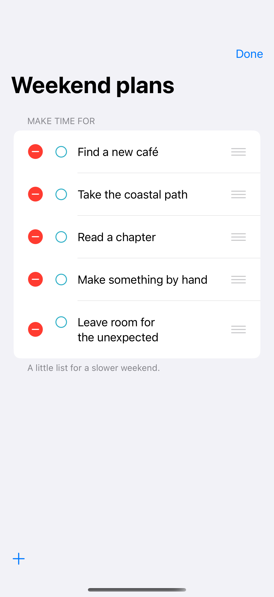

# Editing and reordering

Edit mode exposes native deletion and drag handles for an ordered list.

## SwiftUI

```swift
import SwiftUI

struct ReorderableList: View {
    @State private var ideas = ["Find a café", "Take a walk", "Read a chapter"]

    var body: some View {
        NavigationStack {
            List {
                ForEach(ideas, id: \.self) { Text($0) }
                    .onDelete { ideas.remove(atOffsets: $0) }
                    .onMove { ideas.move(fromOffsets: $0, toOffset: $1) }
            }
            .toolbar { EditButton() }
        }
    }
}
```

## Captures

<!-- captures:start -->
### iPhone 16 Pro · iOS 18.5

default. light appearance; Large text; en_US.



### iPhone 17 Pro · iOS 26.5

default. light appearance; Large text; en_US.


<!-- captures:end -->

## Full example

[Open the complete runnable example](ListEditingReorderingDemo.swift).

## Reference

[Apple: EditButton](https://developer.apple.com/documentation/swiftui/list).
