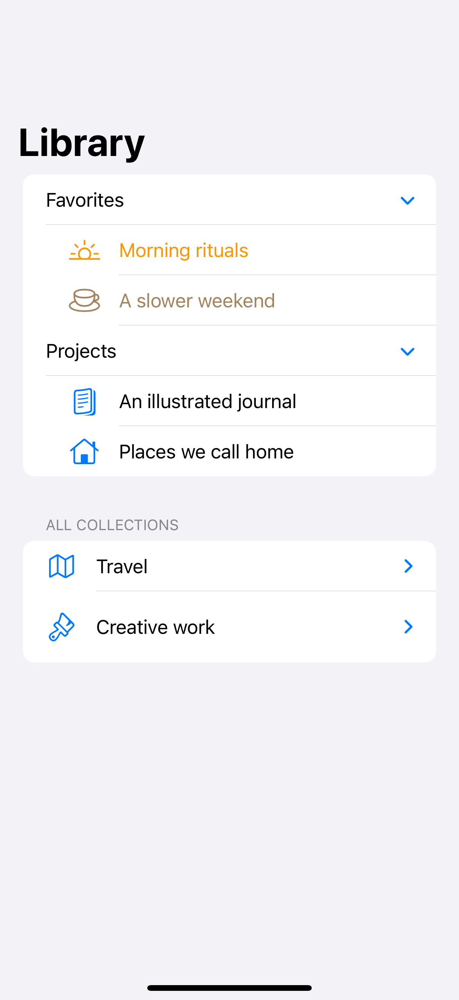
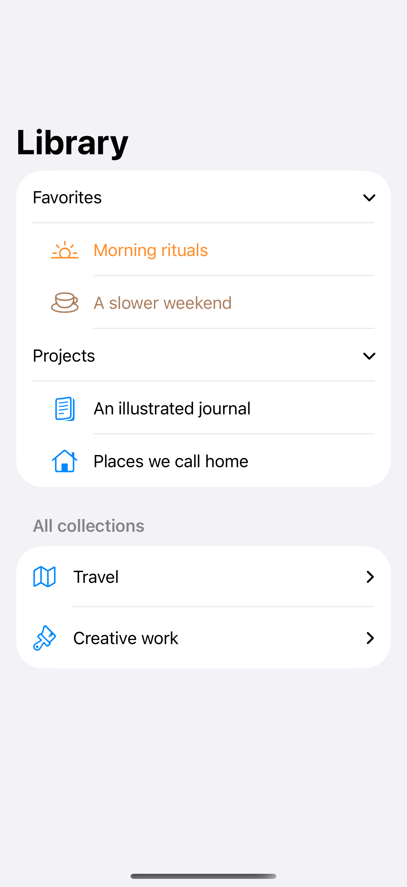
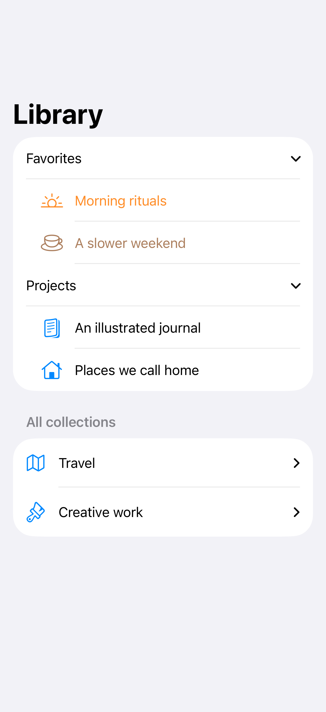

# Outlines and expandable sections

Disclosure groups reveal a hierarchy without leaving the surrounding list.

## SwiftUI

```swift
import SwiftUI

struct FolderOutline: View {
    struct Folder: Identifiable {
        let id: String
        var children: [Folder]?
    }
    private let folders = [
        Folder(id: "Travel", children: [
            Folder(id: "Coastal walks"),
            Folder(id: "City weekends")
        ])
    ]

    var body: some View {
        List {
            OutlineGroup(folders, children: \.children) { folder in
                Label(folder.id, systemImage: "folder")
            }
        }
    }
}
```

## Captures

<!-- captures:start -->
### iPhone 16 Pro · iOS 18.5

default. light appearance; Large text; en_US.



### iPhone 17 Pro · iOS 26.5

default. light appearance; Large text; en_US.



### iPhone 18 Pro · iOS 27.0

default. light appearance; Large text; en_US.


<!-- captures:end -->

## Full example

[Open the complete runnable example](ListOutlineHierarchyDemo.swift).

## Reference

[Apple: OutlineGroup](https://developer.apple.com/documentation/swiftui/outlinegroup).
