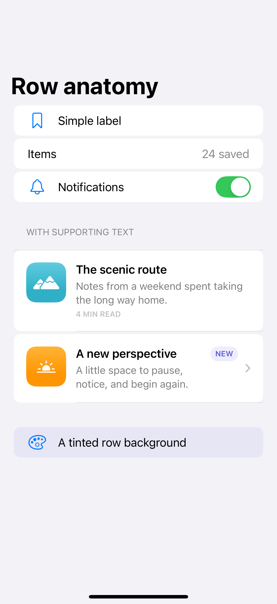
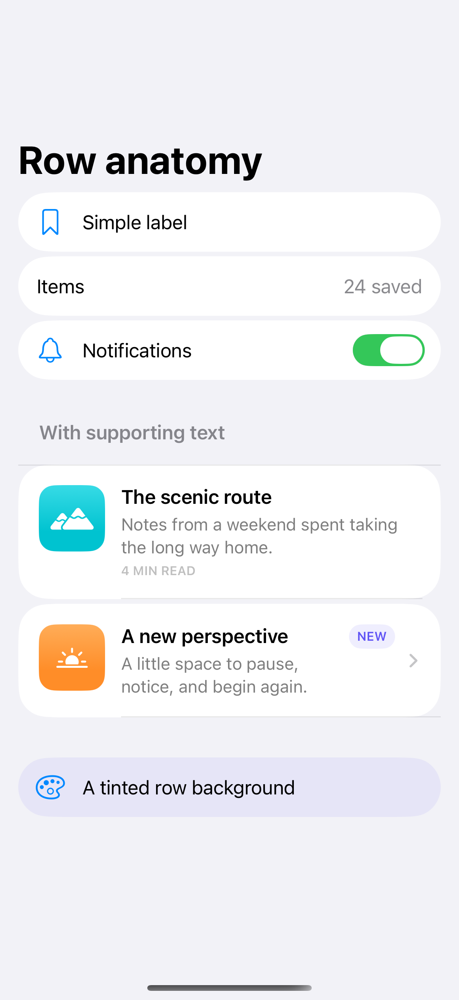

# Row anatomy

Rows combine text, symbols, thumbnails, values, and controls within a consistent alignment.

## SwiftUI

```swift
import SwiftUI

struct ArticleRow: View {
    var body: some View {
        List {
            HStack(alignment: .top, spacing: 14) {
                Image(systemName: "mountain.2.fill")
                    .frame(width: 52, height: 52)
                    .background(.teal.opacity(0.1), in: .rect(cornerRadius: 12))
                VStack(alignment: .leading, spacing: 4) {
                    Text("The scenic route").font(.headline)
                    Text("Notes from a slower weekend.")
                        .font(.subheadline).foregroundStyle(.secondary)
                }
            }
            .listRowInsets(EdgeInsets(top: 16, leading: 16, bottom: 16, trailing: 16))
            .listRowSeparator(.hidden)
        }
    }
}
```

## Captures

<!-- captures:start -->
### iPhone 16 Pro · iOS 18.5

default. light appearance; Large text; en_US.



### iPhone 17 Pro · iOS 26.5

default. light appearance; Large text; en_US.


<!-- captures:end -->

## Full example

[Open the complete runnable example](ListRowAnatomyDemo.swift).

## Reference

[Apple: LabeledContent](https://developer.apple.com/documentation/swiftui/list).
