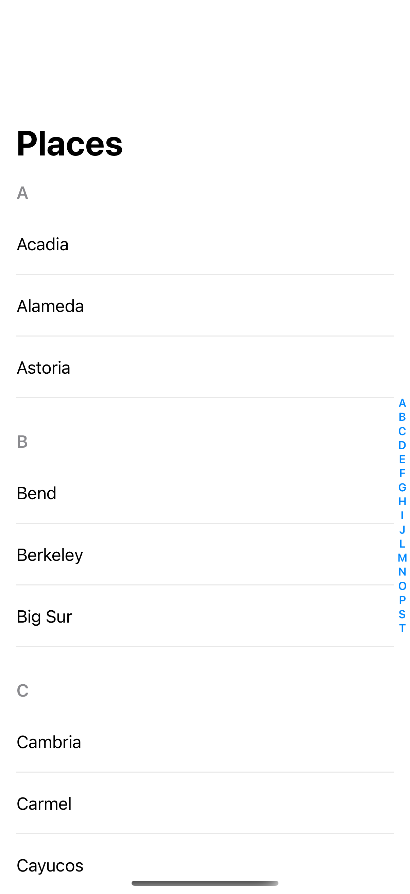

# Section indexes

An alphabetical section index lets people jump through a long list.

## SwiftUI

```swift
import SwiftUI

@available(iOS 26.0, *)
struct IndexedPlaces: View {
    private let places = ["A": ["Acadia", "Astoria"], "B": ["Bend", "Big Sur"]]

    var body: some View {
        List {
            ForEach(places.keys.sorted(), id: \.self) { letter in
                Section(letter) {
                    ForEach(places[letter] ?? [], id: \.self) { Text($0) }
                }
                .sectionIndexLabel(letter)
            }
        }
        .listStyle(.plain)
        .listSectionIndexVisibility(.visible)
    }
}
```

## Captures

<!-- captures:start -->
### iPhone 17 Pro · iOS 26.5

default. light appearance; Large text; en_US.


<!-- captures:end -->

## Full example

[Open the complete runnable example](ListSectionIndexDemo.swift).

## Reference

[Apple: sectionIndexLabel](https://developer.apple.com/documentation/swiftui/view/listsectionindexvisibility(_:)).
