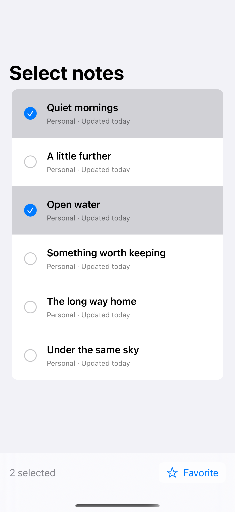
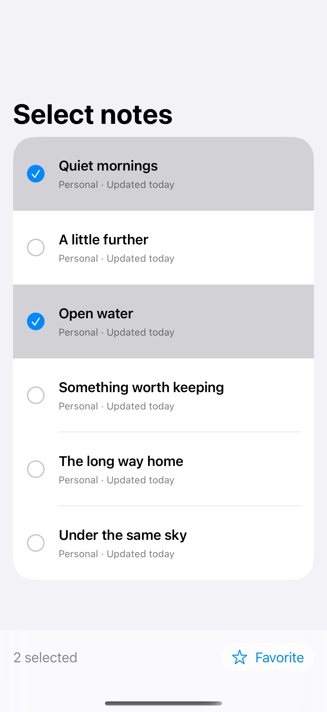
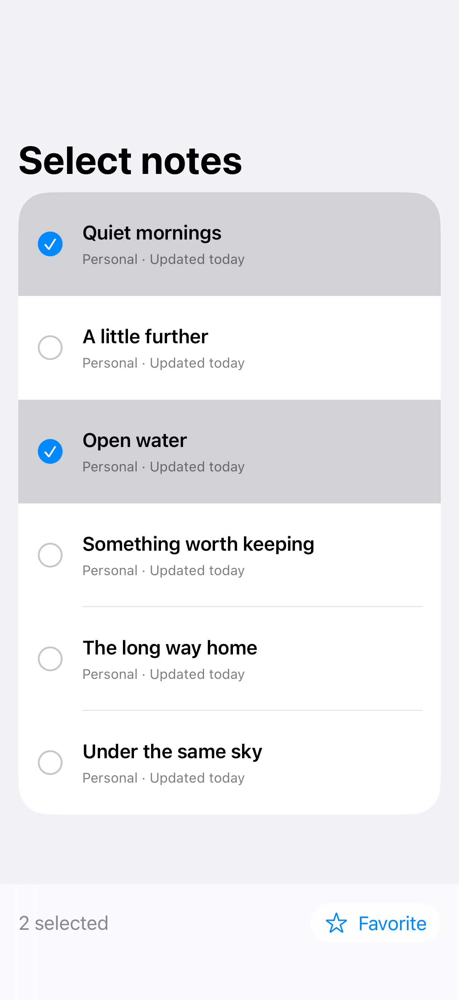

# List selection

Native list selection supports one item or a set of items for batch actions.

## SwiftUI

```swift
import SwiftUI

struct SelectableNotes: View {
    @State private var selected: Set<String> = []
    private let notes = ["Quiet mornings", "Open water", "The long way home"]

    var body: some View {
        List(notes, id: \.self, selection: $selected) { note in
            Text(note).tag(note)
        }
        .environment(\.editMode, .constant(.active))
        .safeAreaInset(edge: .bottom) {
            Text("\(selected.count) selected").padding()
        }
    }
}
```

## Captures

<!-- captures:start -->
### iPhone 16 Pro · iOS 18.5

default. light appearance; Large text; en_US.



### iPhone 17 Pro · iOS 26.5

default. light appearance; Large text; en_US.



### iPhone 18 Pro · iOS 27.0

default. light appearance; Large text; en_US.


<!-- captures:end -->

## Full example

[Open the complete runnable example](ListSelectionDemo.swift).

## Reference

[Apple: List(selection:)](https://developer.apple.com/documentation/swiftui/list).
