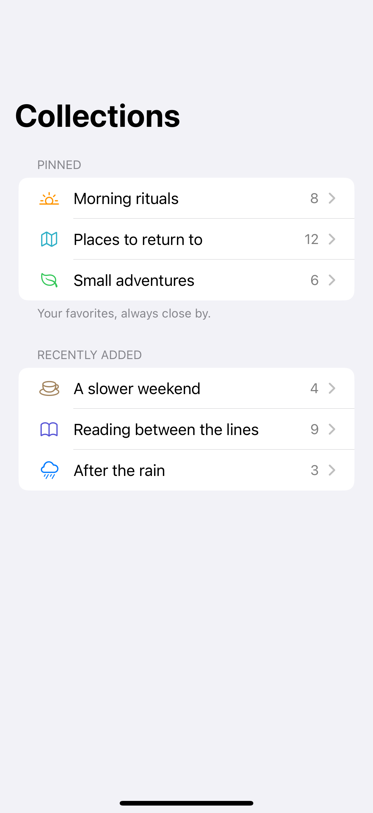
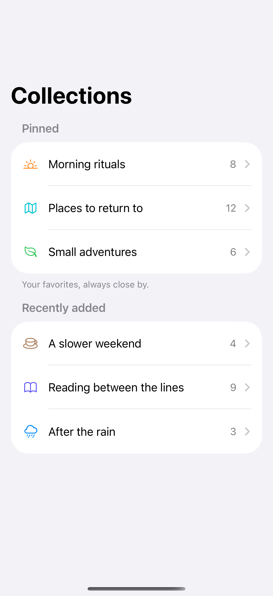

# List styles

Plain, grouped, and inset-grouped lists organize the same rows in different ways.

## SwiftUI

```swift
import SwiftUI

struct GroupedCollections: View {
    var body: some View {
        List {
            Section {
                Label("Morning rituals", systemImage: "sun.horizon")
                Label("Small adventures", systemImage: "leaf")
            } header: {
                Text("Pinned")
            } footer: {
                Text("Your favorites, always close by.")
            }
        }
        .listStyle(.insetGrouped)
    }
}
```

## Captures

<!-- captures:start -->
### iPhone 16 Pro · iOS 18.5

default. light appearance; Large text; en_US.



### iPhone 17 Pro · iOS 26.5

default. light appearance; Large text; en_US.


<!-- captures:end -->

## Full example

[Open the complete runnable example](ListStylesDemo.swift).

## Reference

[Apple: List](https://developer.apple.com/documentation/swiftui/list).
