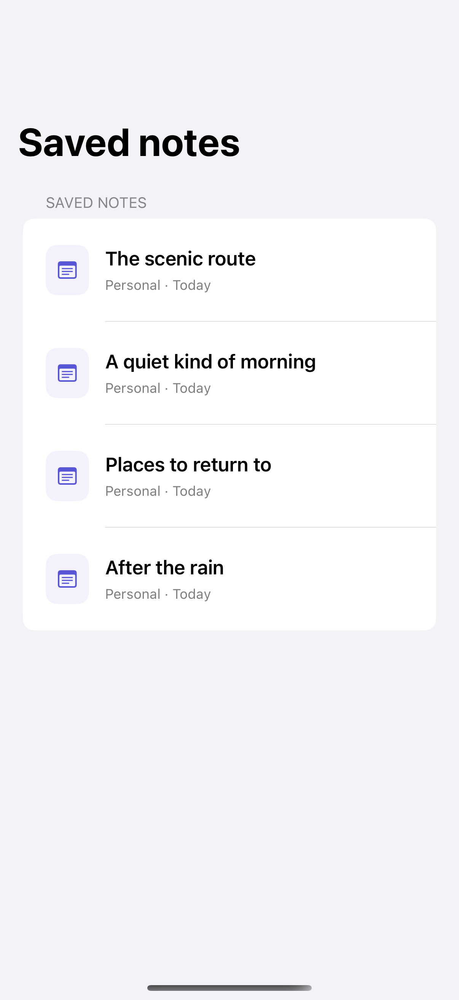
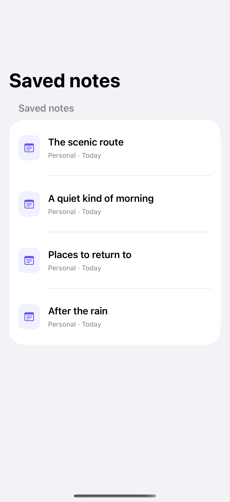

# Swipe actions

Leading and trailing swipe actions put contextual commands on individual rows.

## SwiftUI

```swift
import SwiftUI

struct SwipeNotes: View {
    @State private var notes = ["The scenic route", "After the rain"]
    @State private var pinned: Set<String> = []

    var body: some View {
        List(notes, id: \.self) { note in
            Label(note, systemImage: pinned.contains(note) ? "pin.fill" : "note.text")
                .swipeActions(edge: .leading) {
                    Button("Pin", systemImage: "pin") { pinned.insert(note) }
                        .tint(.orange)
                }
                .swipeActions(edge: .trailing, allowsFullSwipe: false) {
                    Button("Delete", systemImage: "trash", role: .destructive) {
                        notes.removeAll { $0 == note }
                    }
                }
        }
    }
}
```

## Captures

<!-- captures:start -->
### iPhone 16 Pro · iOS 18.5

default. light appearance; Large text; en_US.



### iPhone 17 Pro · iOS 26.5

default. light appearance; Large text; en_US.


<!-- captures:end -->

## Full example

[Open the complete runnable example](ListSwipeActionsDemo.swift).

## Reference

[Apple: swipeActions](https://developer.apple.com/documentation/swiftui/view/swipeactions(edge:allowsfullswipe:content:)).
