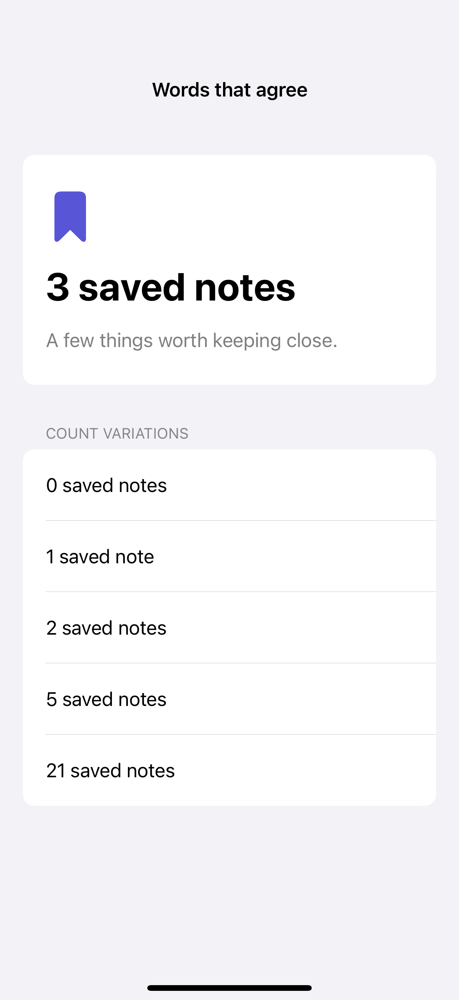
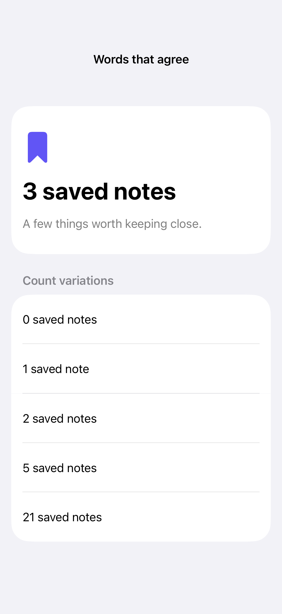

# Grammatical agreement

Automatic inflection can adjust supported words to a count while keeping the full phrase together.

## SwiftUI

```swift
import SwiftUI

struct InflectedCount: View {
    @State private var count = 1

    var body: some View {
        VStack(spacing: 16) {
            Text("^[\(count) saved note](inflect: true)")
            Stepper("Count", value: $count, in: 0...20)
        }
        .environment(\.locale, Locale(identifier: "en_US"))
        .padding()
    }
}
```

## Captures

<!-- captures:start -->
### iPhone 16 Pro · iOS 18.5

default. light appearance; Large text; en_US.



### iPhone 17 Pro · iOS 26.5

default. light appearance; Large text; en_US.


### iPhone 18 Pro · iOS 27.0

default. light appearance; Large text; en_US.


<!-- captures:end -->

## Locale notes

English source copy with a local en_US locale override demonstrates system grammatical agreement. Production translations need String Catalog plural variations and language-specific review; this sample does not claim equivalent grammar in every language.

## Full example

[Open the complete runnable example](GrammaticalPluralAgreementDemo.swift).

## Reference

[Apple: Text](https://developer.apple.com/documentation/foundation/inflectionrule).
