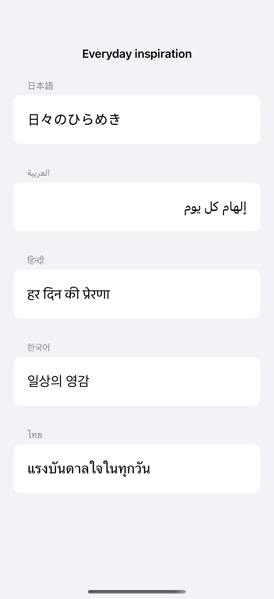
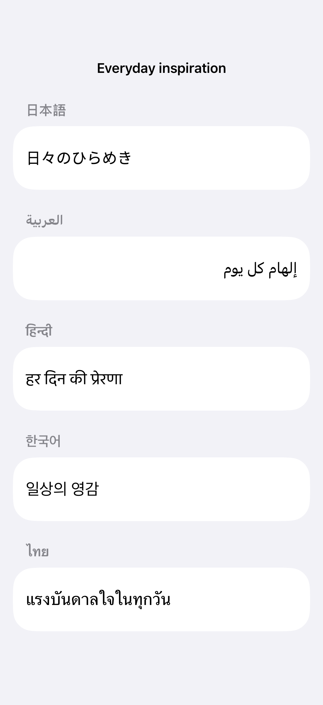

# International scripts and input

System fonts and unrestricted text bindings accommodate different writing systems and ongoing text composition.

## SwiftUI

```swift
import SwiftUI

struct InternationalTextEntry: View {
    @State private var text = "日々のひらめき"

    var body: some View {
        TextField("Sample text", text: $text, axis: .vertical)
            .lineLimit(1...4)
            .textInputAutocapitalization(.never)
            .environment(\.locale, Locale(identifier: "ja"))
            .padding()
        // Avoid replacing the binding on every keystroke;
        // composition may not be committed yet.
    }
}
```

## Captures

<!-- captures:start -->
### iPhone 16 Pro · iOS 18.5

default. light appearance; Large text; en_US.



### iPhone 17 Pro · iOS 26.5

default. light appearance; Large text; en_US.



### iPhone 18 Pro · iOS 27.0

default. light appearance; Large text; en_US.


<!-- captures:end -->

## Locale notes

Capture includes hand-authored Japanese, Arabic, Hindi, Korean, and Thai fixture strings with per-row locale/direction overrides. Keyboard language follows the person’s enabled keyboards; the app does not change it. Native-speaker review and IME/dictation input checks remain pending.

## Full example

[Open the complete runnable example](InternationalScriptInputDemo.swift).

## Reference

[Apple: TextField](https://developer.apple.com/documentation/swiftui/textfield).
