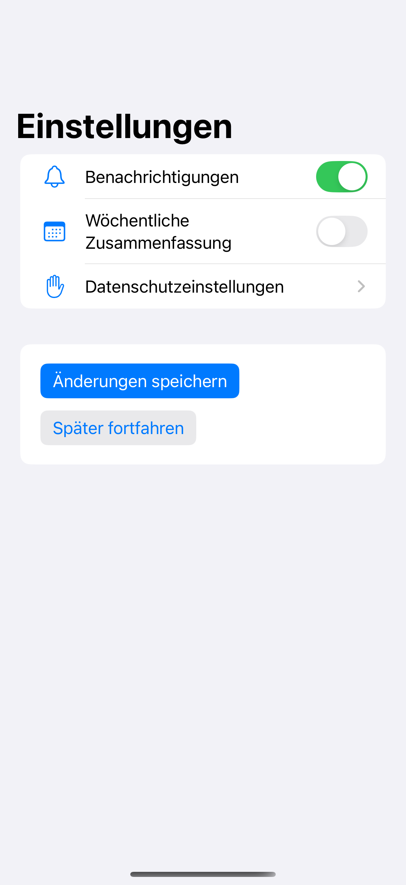
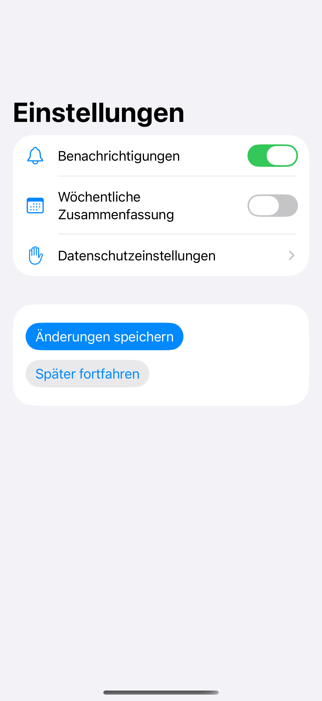

# Text expansion

Flexible rows and multiline buttons leave room for translated labels to become longer.

## SwiftUI

```swift
import SwiftUI

struct ExpandingLabels: View {
    @State private var enabled = true

    var body: some View {
        Form {
            Toggle(isOn: $enabled) {
                Text("Wöchentliche Zusammenfassung")
                    .fixedSize(horizontal: false, vertical: true)
            }
            Button("Änderungen speichern") { }
                .buttonStyle(.borderedProminent)
                .fixedSize(horizontal: false, vertical: true)
        }
    }
}
```

## Captures

<!-- captures:start -->
### iPhone 16 Pro · iOS 18.5

default. light appearance; Large text; en_US.



### iPhone 17 Pro · iOS 26.5

default. light appearance; Large text; en_US.


<!-- captures:end -->

## Locale notes

Capture uses hand-authored German fixture strings with a local de locale override. English and Finnish fixtures are selectable. These are layout fixtures, not a production translation catalog.

## Full example

[Open the complete runnable example](LocalizedTextExpansionDemo.swift).

## Reference

[Apple: fixedSize](https://developer.apple.com/documentation/swiftui/view/fixedsize(horizontal:vertical:)).
