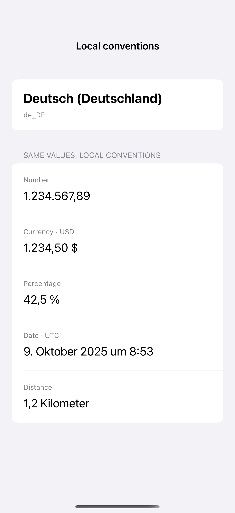
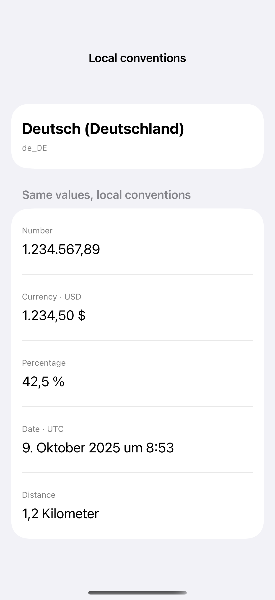

# Localized value formats

Locale-aware format styles control dates, currencies, numbers, percentages, and measurements consistently.

## SwiftUI

```swift
import SwiftUI

struct LocaleAwareValues: View {
    private let locale = Locale(identifier: "de_DE")

    var body: some View {
        VStack(alignment: .leading, spacing: 12) {
            Text(1234.5.formatted(.number.locale(locale)))
            Text(1234.5.formatted(.currency(code: "USD").locale(locale)))
            Text(0.425.formatted(.percent.locale(locale)))
        }
        .padding()
    }
}
```

## Captures

<!-- captures:start -->
### iPhone 16 Pro · iOS 18.5

default. light appearance; Large text; en_US.



### iPhone 17 Pro · iOS 26.5

default. light appearance; Large text; en_US.


<!-- captures:end -->

## Locale notes

Capture explicitly formats fixed sample values using de_DE. UI labels remain English. Currency stays USD across locales, and the fixed date is displayed in UTC; global region and time zone are untouched.

## Full example

[Open the complete runnable example](LocalizedValueFormatsDemo.swift).

## Reference

[Apple: Locale](https://developer.apple.com/documentation/foundation/formatstyle).
