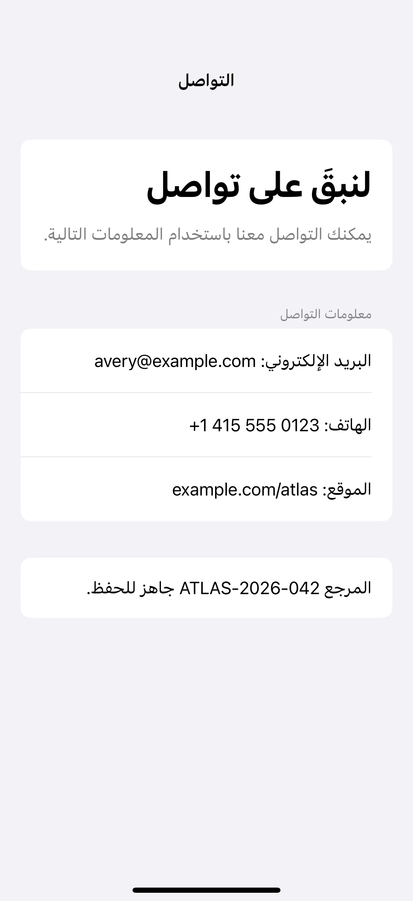
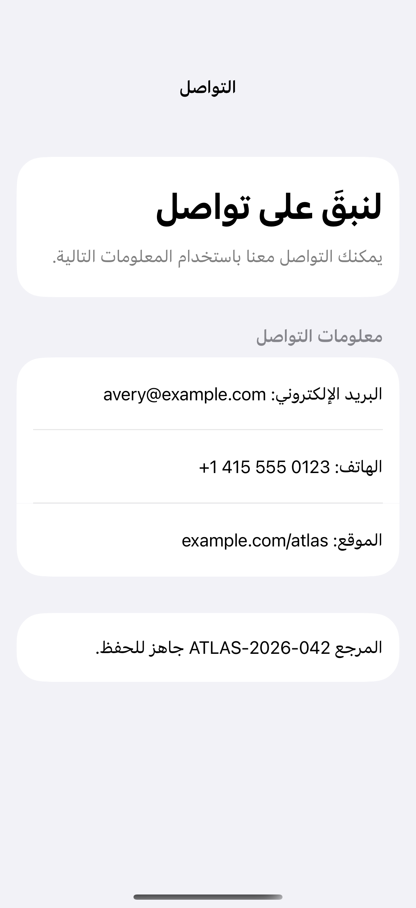

# Mixed-direction text

Direction isolation keeps addresses, phone numbers, and other left-to-right fragments readable within right-to-left text.

## SwiftUI

```swift
import SwiftUI

struct MixedDirectionLabel: View {
    private let email = "avery@example.com"

    var body: some View {
        // FSI and PDI isolate the inserted fragment's direction.
        Text("البريد الإلكتروني: \u{2068}\(email)\u{2069}")
            .textSelection(.enabled)
            .environment(\.locale, Locale(identifier: "ar"))
            .environment(\.layoutDirection, .rightToLeft)
            .padding()
    }
}
```

## Captures

<!-- captures:start -->
### iPhone 16 Pro · iOS 18.5

default. light appearance; Large text; en_US.



### iPhone 17 Pro · iOS 26.5

default. light appearance; Large text; en_US.


<!-- captures:end -->

## Locale notes

Capture uses Arabic fixture text, Unicode FSI/PDI isolation, and local ar / rightToLeft overrides. The example.com address and 555 phone number are fictional sample data.

## Full example

[Open the complete runnable example](MixedDirectionContentDemo.swift).

## Reference

[Apple: layoutDirection](https://developer.apple.com/design/human-interface-guidelines/right-to-left).
