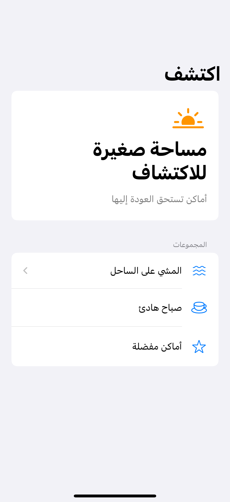
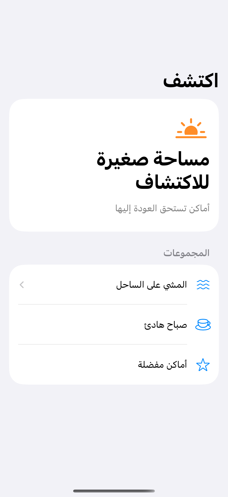

# Right-to-left layouts

Semantic leading and trailing alignment lets a native interface mirror for right-to-left languages.

## SwiftUI

```swift
import SwiftUI

struct MirroredCollection: View {
    var body: some View {
        NavigationStack {
            List {
                NavigationLink {
                    Text("طريق على الساحل")
                } label: {
                    Label("المشي على الساحل", systemImage: "water.waves")
                }
            }
            .navigationTitle("اكتشف")
        }
        .environment(\.locale, Locale(identifier: "ar"))
        .environment(\.layoutDirection, .rightToLeft)
    }
}
```

## Captures

<!-- captures:start -->
### iPhone 16 Pro · iOS 18.5

default. light appearance; Large text; en_US.



### iPhone 17 Pro · iOS 26.5

default. light appearance; Large text; en_US.


<!-- captures:end -->

## Locale notes

Capture uses Arabic fixture copy and local ar / rightToLeft environment overrides. Global device language and region remain unchanged.

## Full example

[Open the complete runnable example](RightToLeftLayoutDemo.swift).

## Reference

[Apple: layoutDirection](https://developer.apple.com/documentation/swiftui/layoutdirection).
