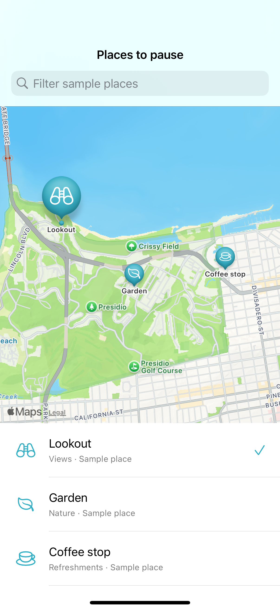

# Results connected to a map

Filtering a local fixture keeps map markers and result rows in sync without a search service; base-map imagery may still require a network connection.

## SwiftUI

```swift
import SwiftUI
import MapKit

struct FilteredSampleMarkers: View {
    @State private var query = ""
    private let names = ["Lookout", "Garden", "Coffee stop"]
    var body: some View {
        Map {
            ForEach(names.indices.filter { query.isEmpty || names[$0].localizedCaseInsensitiveContains(query) }, id: \.self) { index in
                Marker(names[index], coordinate: CLLocationCoordinate2D(latitude: 37.80 + Double(index) * 0.003, longitude: -122.46))
            }
        }.searchable(text: $query, prompt: "Filter sample places")
    }
}
```

## Captures

<!-- captures:start -->
### iPhone 16 Pro · iOS 18.5

default. light appearance; Large text; en_US.


<!-- captures:end -->

## Full example

[Open the complete runnable example](MapLocalSearchResultsDemo.swift).

## Reference

[Apple: searchable](https://developer.apple.com/documentation/mapkit/map).
