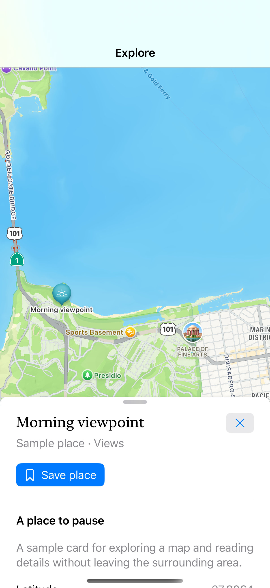

# A map with a movable sheet

A place sheet uses multiple detents and leaves the background map interactive at its smaller heights; sample details remain available without map tiles.

## SwiftUI

```swift
import SwiftUI
import MapKit

struct MapAndSheet: View {
    @State private var presented = false
    var body: some View {
        Map {
            Marker("Sample place", coordinate: CLLocationCoordinate2D(latitude: 37.8064, longitude: -122.4702))
        }
        .overlay(alignment: .bottom) { Button("Details") { presented = true }.buttonStyle(.borderedProminent).padding() }
        .sheet(isPresented: $presented) {
            Text("Sample place details").padding()
                .presentationDetents([.height(250), .medium, .large])
                .presentationBackgroundInteraction(.enabled(upThrough: .medium))
        }
    }
}
```

## Captures

<!-- captures:start -->
### iPhone 16 Pro · iOS 18.5

default. light appearance; Large text; en_US.


<!-- captures:end -->

## Full example

[Open the complete runnable example](MapMovablePlaceSheetDemo.swift).

## Reference

[Apple: presentationDetents](https://developer.apple.com/documentation/swiftui/view/presentationbackgroundinteraction(_:)).
